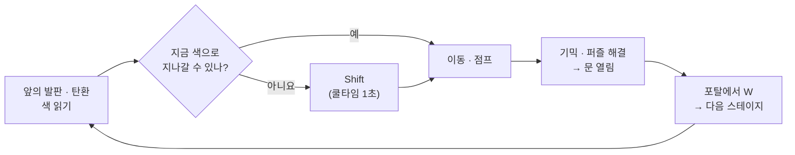
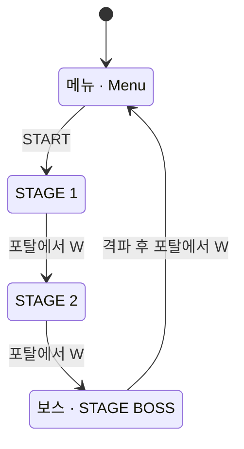
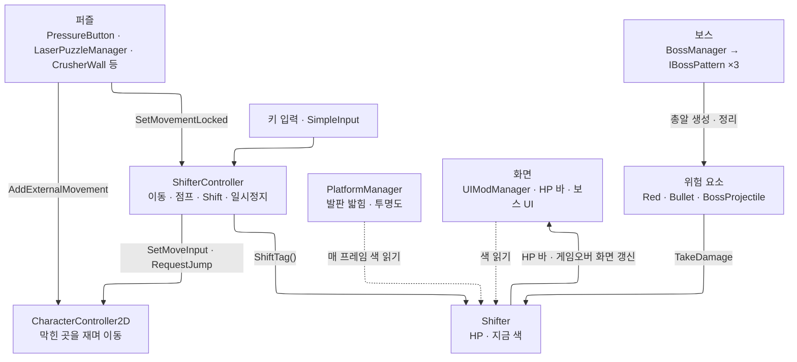
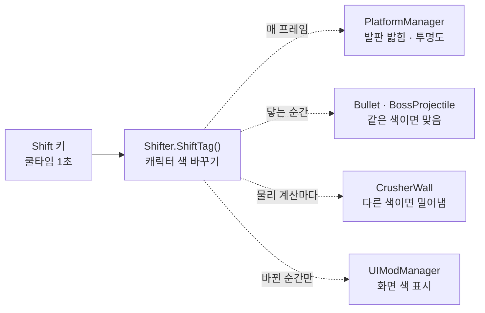
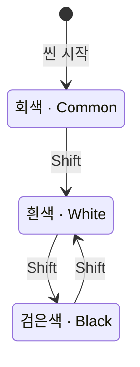
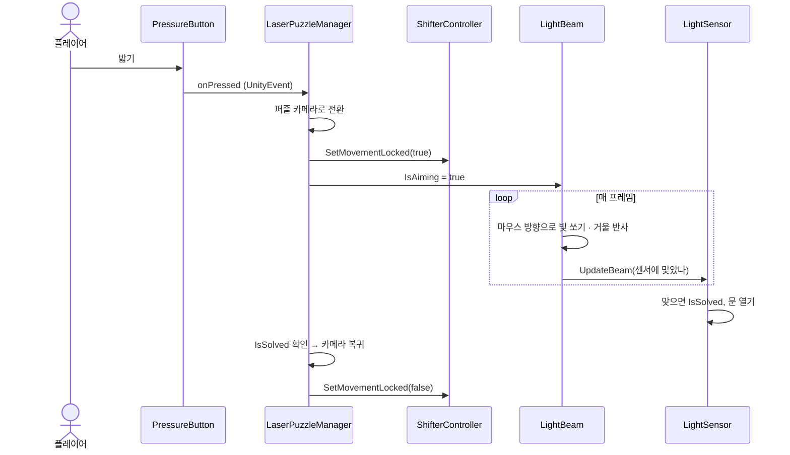
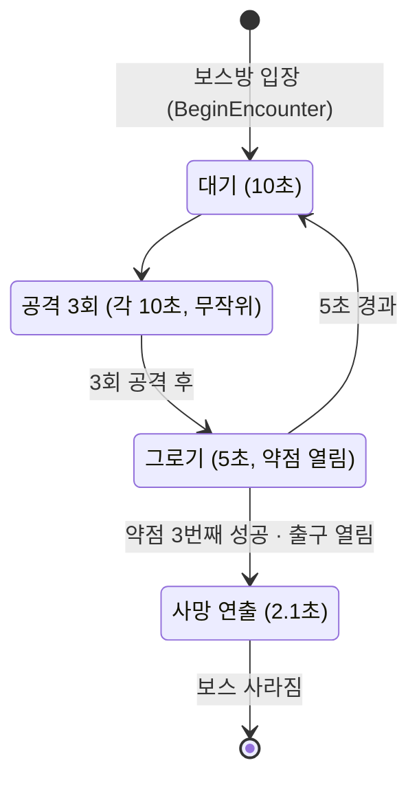
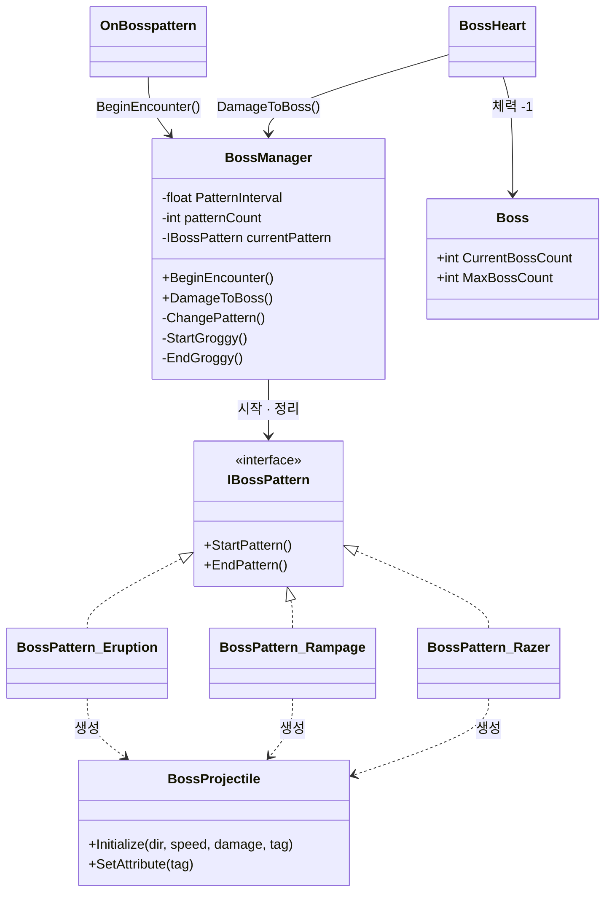

# SHIFTER 기술 문서

> Shift 키로 캐릭터의 색을 흰색 ↔ 검은색으로 바꾸면, 밟을 수 있는 발판과 맞는 총알이 함께 뒤집히는 **2D 퍼즐 플랫포머**
>
> Unity 6 · C# · 1인 개인 프로젝트 · 2026.06.24 \~ 2026.07.10


**한눈에 보기**

- **무엇을**: 키 하나(Shift)로 캐릭터의 색을 흰색 ↔ 검은색으로 바꾸면, 밟을 수 있는 발판과 맞는 총알이 함께 바뀌는 2D 퍼즐 플랫포머. 스테이지 2개(기믹 7종)와 보스전 1개
- **핵심 설계**: "캐릭터와 같은 색인가?"라는 질문 하나로 발판 · 총알 · 퍼즐을 모두 판단 · 다른 색 발판은 부딪힘 판정째 꺼서 캐릭터 이동과 레이저가 같은 규칙을 따름 · 보스 공격 3종은 '시작'과 '뒷정리'만 약속한 같은 틀(`IBossPattern`)로 통일
- **결과**: 혼자 약 2주 만에 메뉴부터 보스 격파까지 한 판 완성(07.07) · STAGE 2의 발판 20개와 레이저 퍼즐을 코드 수정 없이 같은 규칙에 맞춤 · 보스전 랜덤 발판이 캐릭터를 가둘 수 있다는 것을 찾아, 공정하지 않다고 판단해 기능을 뺌(07.10) · 코드 정리(리팩토링) 중 되살아난 빌드 오류를 다시 찾아 고침(11.09)
- **보여 주는 역량**: 규칙 하나로 여러 기능을 묶는 설계([7.1](#71-결과)) · 버그 원인을 코드 한 줄까지 추적([7.2 ②](#72-문제-해결-경험)) · 고치는 비용이 크면 기능을 빼는 판단([5.4 결정 2](#54-고민과-선택))

## 목차

1. [프로젝트 개요](#1-프로젝트-개요)
2. [시스템 구조](#2-시스템-구조)
3. [Shift 속성 시스템](#3-shift-속성-시스템)
4. [스테이지 기믹과 퍼즐](#4-스테이지-기믹과-퍼즐)
5. [보스전](#5-보스전)
6. [이동과 공통 시스템](#6-이동과-공통-시스템)
7. [결과 및 배운 점](#7-결과-및-배운-점)

---

## 1. 프로젝트 개요

### 1.1 무엇을 만들었나 (What)

**SHIFTER**는 캐릭터(Shifter)의 색을 흰색 ↔ 검은색으로 바꿔 가며 스테이지를 통과하는 2D 퍼즐 플랫포머입니다. 규칙은 하나, **같은 색이면 실체이고 다른 색이면 허상**입니다.

- **발판**은 캐릭터와 **같은 색일 때만 밟힙니다.** 다른 색 발판은 반투명해지고 몸이 그대로 빠져나갑니다.
- **총알**도 **같은 색일 때만 맞습니다.** 다른 색 총알은 몸을 지나갑니다.
- 그래서 Shift를 누르는 순간 '밟을 수 있는 곳'과 '맞는 총알'이 한꺼번에 뒤집힙니다. 흰 발판을 밟으려면 흰색이어야 하고, 흰색인 동안에는 흰 총알을 피해야 합니다. Shift는 한 번 쓰면 1초 뒤에야 다시 쓸 수 있어(쿨타임), 연타로 모든 상황을 넘길 수는 없습니다.


*같은 자리에서 Shift만 눌러 흰색(왼쪽)과 검은색(오른쪽)을 비교한 화면. 흰색일 때는 위·아래 검은 발판이 반투명하고, 검은색이 되면 검은 발판이 진해지는 대신 캐릭터가 선 흰 발판이 반투명해집니다. 흰 발판은 회색 돌 모양이라 반투명해져도 차이가 작습니다.*

| 스테이지 | 내용 |
|---|---|
| STAGE 1 | 밟고 있으면 HP가 깎이는 레드 타일, 흰·검 총알 발사기, 박스 운반 퍼즐, 전구 퍼즐 |
| STAGE 2 | 위아래로 움직이는 발판, 거울로 레이저를 꺾는 퍼즐, 밀려오는 흰·검 벽(크러셔 벽) |
| STAGE BOSS | 보스 **AGIS - RED MARTYR**. 공격을 3번 하고 나면 5초 동안 멈춰 약점을 드러낸다(그로기). 그때마다 약점을 위에서 한 번 밟을 수 있고, 3번 맞히면 격파 |


*인게임 화면(STAGE 2, 흰색 상태). 왼쪽 위에 지금 색, 아래에 HP 바가 표시됩니다. 캐릭터가 선 회색 돌 발판이 흰 발판이고, 오른쪽에 반투명하게 보이는 어두운 발판은 지금 색으로는 밟을 수 없는 검은 발판입니다.*

이 문서는 게임을 이루는 시스템 중 아래 **세 가지**의 설계·구현과 선택의 이유를 다룹니다.

| 핵심 기능 | 한 줄 요약 | 장 |
|---|---|---|
| Shift 속성 시스템 | 발판 · 총알 · 화면 표시를 모두 "캐릭터와 같은 색인가?" 하나로 판단한다 | 3 |
| 스테이지 기믹과 퍼즐 | 버튼은 '밟혔다'만 알리고 할 일은 에디터에서 연결한다. 레이저 반사와 밀어내는 벽은 엔진의 자동 물리 대신 직접 계산한다 | 4 |
| 보스전 | 공격 3종이 '시작'과 '뒷정리'를 스스로 맡아 이전 총알이 남지 않는다. 공격 3번 → 5초 빈틈(그로기) → 약점을 반복한다 | 5 |

### 1.2 왜 이렇게 만들었나 (Why)

**색 하나를 고르면 그 색의 길과 위험을 함께 떠안는 플랫포머를 만들고자 했습니다.**

이 게임의 재미는 **Shift 한 번에 '밟을 수 있는 곳'과 '맞는 총알'이 동시에 뒤집히는 데** 있습니다. 이 규칙을 약 2주 안에 스테이지 2개와 보스전에 걸쳐 구현하면서 부딪힌 문제는 세 가지였습니다.

| 문제 | 구체적 상황 | 해결 방향 |
|---|---|---|
| 키 하나가 여러 대상을 동시에 바꾼다 | Shift 한 번에 발판(한 스테이지에 흰·검 최대 20개)의 밟힘과 투명도, 총알 피격, 화면의 색 표시가 함께 바뀌어야 한다. 대상마다 따로 만들면 규칙이 조금씩 어긋난다 | 색을 이름표(태그) 하나로 통일하고 "같은 색인가"만 묻는다 (3장) |
| 장치마다 조작이 다르고, 밀기 · 밀리기를 직접 만들어야 한다 | 박스 밀기 · 전구 토글 · 레이저 조준 · 밀려오는 벽은 조작과 판정이 모두 다르다. 캐릭터는 엔진의 자동 물리를 쓰지 않아(키네마틱 이동), 밀고 밀리는 동작이 저절로 생기지 않는다 | 버튼은 '밟혔다'만 알리고, 캐릭터를 움직이는 코드는 `CharacterController2D` 한 곳으로 모은다 (4장) |
| 공격이 바뀌어도 화면이 깨끗해야 한다 | 보스 공격 3종이 10초마다 무작위로 바뀌고, 3번 뒤 빈틈(그로기)이 온다. 난사 공격 한 번에 총알이 40발 생기는데, 남은 총알이 다음 공격이나 빈틈 시간에 섞이면 안 된다 | 공격마다 시작과 뒷정리를 스스로 책임지게 한다 (5장) |

목표는 **7월 초까지 메뉴 → STAGE 1 → STAGE 2 → 보스 격파로 이어지는 한 판을 완성하고, 모든 기믹을 Shift 규칙 하나로 설명할 수 있게 만드는 것**이었습니다.

### 1.3 핵심 루프



플레이어는 스테이지 내내 "지금 색으로 저 발판을 밟을 수 있나", "저 총알은 내 색인가"를 판단합니다. 쿨타임 1초 때문에 **언제 바꿀지**도 함께 골라야 합니다. 보스전에서는 쏟아지는 총알 속에서 같은 판단을 반복하다가, 보스가 멈춘 5초 안에 약점을 밟습니다.

### 1.4 조작법

| 상황 | 입력 | 동작 |
|---|---|---|
| 공통 | A · D / ← · → | 좌우 이동 (초당 8유닛) |
| 공통 | Space | 점프. 공중에서 한 번 더 (2단 점프) |
| 공통 | Shift (왼쪽 · 오른쪽) | 색 바꾸기. 처음엔 회색, 이후 흰 ↔ 검 (쿨타임 1초) |
| 공통 | Esc | 일시정지 · 해제 |
| 포탈 안 | W / ↑ | 다음 스테이지로 |
| 레이저 퍼즐 조준 모드 | 마우스 | 빛의 방향 |

### 1.5 레퍼런스

| 게임 | 참고한 점 | 이 프로젝트에서 다른 점 |
|---|---|---|
| Outland | 색(빛·어둠)을 바꿔 같은 공간의 지형과 탄막을 다르게 통과하는 2D 플랫포머 | Outland는 같은 색 탄환이 무해하지만, 이 게임은 반대로 **같은 색 탄환에 맞는다.** 같은 색이어야 밟히는 발판과 맞물려, 한 색을 고르면 그 색의 발판과 탄환을 함께 떠안는다. 전환에는 1초 쿨타임이 있다 |

### 1.6 개발 환경

| 항목 | 내용 |
|---|---|
| 엔진 | Unity 6 (6000.3.15f1), URP 2D |
| 언어 | C# |
| 주요 패키지 | Input System, uGUI + TextMeshPro |
| 공용 코드 | 강의에서 받은 `Study.Utilities`: 캐릭터 이동(`CharacterController2D`, 박스 밀기는 직접 추가 → [6장 ①](#6-이동과-공통-시스템))과 키 입력 읽기(`SimpleInput`) |
| 외부 에셋 | 플레이어·보스·타일·배경·UI 스프라이트와 Super Pixel Projectiles Pack 1(보스 탄환). 모두 구매하거나 무료로 배포된 에셋을 사용 |
| 도구 | JetBrains Rider, Git / GitHub |
| 기간 | 2026.06.24 \~ 2026.07.10 (07.07 완성, 07.10 리팩토링) · 2026.11.09 문서화 검수 (테스트 플레이, 빌드 에러 재수정) |
| 인원 | 1인 |
| 규모 | C# 스크립트 33개(약 1,900줄, `Assets/Scripts` 기준 · 공용 유틸리티 제외), 씬 4개 |
| 상태 | 07.07 완성. 11.09 테스트 플레이에서 찾은 미수정 버그 3건(STAGE 1 총알이 맞지 않음 · STAGE 2 레드 타일 피해 없음 · 보스 레이저가 바로 사라짐) → [7.3 ①](#73-아쉬운-점과-향후-계획) |

### 1.7 링크

- GitHub: https://github.com/rlawlsdn77/Unity-2D-Shifter
<!-- ✍️ 시연 영상이 생기면 이 자리에 "- 시연 영상: <주소>" 줄을 추가. '(추가 예정)' 같은 빈 자리표시자는 읽는 사람에게 '링크 없음'과 같아서 뺐습니다 -->

---

## 2. 시스템 구조

### 2.1 씬 구성과 흐름

| 씬 | 역할 | 주요 구성 |
|---|---|---|
| Menu | 시작, 조작법(HOW TO PLAY), 종료 | `SceneChanger` |
| STAGE 1 | 기초 기믹. 흰 발판 4 · 검 발판 3 · 레드 타일 5 | `BulletLauncher` ×4, `BoxGoal`, `ButtontoLight` ×5 · `ButtonReset` |
| STAGE 2 | 응용 기믹. 흰 발판 9 · 검 발판 11 · 레드 타일 3 | `MovingPlatform` ×3, `LaserPuzzleManager` · `LightBeam` · `Mirror` ×3 · `LightSensor`, `CrusherWall` |
| STAGE BOSS | 보스전. 검 발판 1 · 레드 타일 6 | `BossManager` · 공격 3종, `BossHeart`, `OnBosspattern`, 보스 UI |

씬은 게임의 한 화면 단위입니다. 세 스테이지 씬에는 공통으로 캐릭터(`Shifter`), 화면 UI(HP · 지금 색 · 일시정지 · 게임오버 · 보스 UI), 발판 관리자(`PlatformManager`), 카메라(`CameraController`), 레드 타일(`Red`), 다음 스테이지로 가는 포탈이 들어 있습니다.



- 포탈은 빌드에 등록한 순서상 다음 씬으로 넘어갑니다. 마지막 씬 다음은 처음(메뉴)이라, 보스방 포탈은 메뉴로 돌아갑니다.
- 스테이지 사이에 이어지는 값은 없습니다. 스테이지마다 HP 100, 회색에서 새로 시작합니다.

| 메뉴 | 게임오버 | 일시정지 |
|---|---|---|
|  |  |  |

*메뉴에는 조작법(HOW TO PLAY)과 START · Exit Game 버튼이 있습니다. HP가 0이 되면 게임오버 화면이 뜨고 시간이 멈추며, Esc는 일시정지 화면을 엽니다. 두 화면 모두 지금 스테이지를 처음부터 다시 하는 버튼(RESTART · Restart)과 메뉴로 돌아가는 버튼(MENU · Main)이 있습니다.*

### 2.2 아키텍처



> 실선은 직접 호출, 점선은 값을 읽기만 하는 관계입니다. 플레이어의 속성(태그)을 **바꾸는** 곳은 `Shifter.ShiftTag()` 하나이고, 나머지는 모두 읽기만 합니다. 스테이지를 시작할 때 회색으로 맞추는 것만 예외입니다. 색을 바꾸는 곳이 하나뿐이라, 발판 · 총알 · 화면이 서로 다른 색을 보는 일이 없습니다. HP는 반대로 `Shifter`가 HP 바와 게임오버 화면을 직접 바꿉니다.

### 2.3 설계 규칙

게임 전체에 걸친 규칙은 네 가지입니다. 왜 이렇게 정했는지는 각 장의 '고민과 선택'에서 설명합니다.

1. **색은 이름표(태그) 하나로 나타낸다.** 태그는 Unity에서 오브젝트에 붙이는 이름표입니다. 캐릭터 · 발판 · 총알이 같은 이름표(`Common`/`White`/`Black`)를 달고, 판단은 "이름표가 같은가"(`CompareTag`) 하나로 합니다. → [3장](#3-shift-속성-시스템)
2. **같은 색이면 실체, 다른 색이면 허상.** 발판은 같은 색일 때 밟히고, 총알은 같은 색일 때 맞습니다. STAGE 2의 크러셔 벽만 일부러 반대로 했습니다. → [3.1](#31-문제와-구조)
3. **캐릭터를 움직이는 길은 `CharacterController2D` 하나.** 이 게임의 캐릭터는 중력 · 밀림 같은 엔진의 자동 물리를 쓰지 않고, 코드가 위치를 직접 정합니다(키네마틱 이동). 키 입력(`SetMoveInput`)도, 밖에서 미는 힘(`AddExternalMovement`)도 이 코드로만 들어가고, 움직이기 전에 항상 앞이 막혔는지 먼저 잽니다. → [4.4](#44-고민과-선택), [6장 ①](#6-이동과-공통-시스템)
4. **보스 공격은 자기가 만든 것을 스스로 치운다.** 공격마다 '시작'(`StartPattern`)과 '끝'(`EndPattern`)만 밖에 드러내고, 끝날 때 자기가 쏜 총알과 진행 중이던 작업을 모두 정리합니다. → [5장](#5-보스전)

### 2.4 핵심 클래스 역할

클래스는 코드를 기능별로 나눈 단위입니다. 각 클래스가 맡는 일과 맡지 않는 일을 함께 적었습니다.

| 계층 | 클래스 | 맡는 일 | 맡지 않는 일 |
|---|---|---|---|
| 플레이어 | `ShifterController` | 키 입력 → 이동·점프, Shift 쿨타임, 일시정지, 조준 중 이동 잠금 | 색 규칙, HP |
| 플레이어 | `Shifter` | HP(0\~100)와 HP 바, 색 바꾸기, 맞으면 깜빡임, 사망 처리 | 키 입력 읽기 |
| 플레이어 | `CharacterController2D` (공용) | 막힌 곳을 재며 이동, 중력·2단 점프, 밖에서 미는 힘, 박스 밀기 | 키 입력 읽기 |
| 색 | `PlatformManager` | 이름표로 발판을 모아 밟힘·투명도를 캐릭터 색에 맞춘다 | 캐릭터 이동 |
| 색 | `BossAttributeUtil` | 색 이름표 상수, 이름표 → 겉보기 색 변환, 무작위 색, 이름표·색 함께 입히기 | 판정 |
| 색 | `UIModManager` | 색이 바뀐 순간에만 화면의 색 표시 교체 | |
| 기믹 | `Red` | 레드 타일에 닿아 있는 동안 일정 간격으로 HP를 깎는다 | 색 판정 (색과 무관) |
| 기믹 | `BulletLauncher` · `Bullet` | 일정 간격으로 흰/검 총알 발사 · 같은 색 대상에 피해 | |
| 퍼즐 | `PressureButton` | 캐릭터가 밟으면 에디터에서 연결해 둔 일(`UnityEvent`)을 실행 | 무엇을 할지 알기 |
| 퍼즐 | `LaserPuzzleManager` | 조준 모드 시작·끝 (카메라 전환, 이동 잠금) | 빛 계산 |
| 퍼즐 | `LightBeam` · `Mirror` · `LightSensor` | 마우스 방향으로 빛을 쏘고 거울에서 꺾기 · 거울 표시 · 빛이 닿으면 문을 연다 | |
| 퍼즐 | `CrusherWall` | 흰/검 벽 생성·이동, 다른 색이면 캐릭터를 민다 | |
| 퍼즐 | `BoxGoal` · `ButtontoLight` · `ButtonReset` | 박스 골인 시 문 열기 · 전구 토글 · 초기화와 정답 검사 | |
| 보스 | `BossManager` | 공격 교체(10초), 그로기(5초), 사망 연출 | 공격 내용 |
| 보스 | `IBossPattern` 구현 3종 | 공격 하나의 실행과 뒷정리 | 다음 공격 고르기 |
| 보스 | `BossProjectile` · `BossHeart` | 보스 총알의 이동·수명(10초)·같은 색 피격 · 위에서 밟히면 보스 체력 −1 | 그로기 시간 |
| 화면 | `OnBosspattern` · `BossHealthUI` · `BossTimerUI` | 보스방 입장 처리 · 보스 체력 · 격파 시간 표시 | |
| 씬 | `SceneChanger` · `Portal` | 버튼으로 씬 이동 · 포탈에서 다음 씬 | |

---

## 3. Shift 속성 시스템

### 3.1 문제와 구조

**문제.** Shift를 한 번 누르면 네 가지가 동시에 바뀌어야 합니다. ① 흰·검 발판을 밟을 수 있는지 ② 발판의 투명도 ③ 총알에 맞는지 ④ 화면의 색 표시. 이것을 대상마다 따로 만들면 "같은 색이면 실체"라는 규칙이 곳곳에서 조금씩 다르게 만들어지고, 하나를 고칠 때 나머지도 함께 고쳐야 합니다.

**구조.** 색을 이름표(태그) 하나로 통일했습니다. 캐릭터의 이름표를 바꾸는 곳은 `Shifter.ShiftTag()` 하나이고, 나머지는 모두 "캐릭터 이름표와 내 이름표가 같은가"를 읽기만 합니다.



| 대상 | 캐릭터와 같은 색 | 다른 색 | 비고 |
|---|---|---|---|
| 흰·검 발판 | 밟힘 · 불투명 | 통과 · 반투명(50%) | 회색일 때는 흰·검 모두 통과 |
| 회색·빨강 발판 (Common · Red) | 항상 밟힘 | 항상 밟힘 | 빨강은 닿아 있는 동안 HP가 깎임 |
| 총알 (STAGE 1 총알 · 보스 탄) | 맞는다 (피해 후 사라짐) | 통과 | 보스 탄은 회색 지형에 닿으면 사라짐 |
| 크러셔 벽 (STAGE 2) | 통과 | 밀려남 · 반투명 | 발판과 반대 규칙 (일부러 바꾼 변주) |
| 화면 색 표시 | 지금 색 이미지 하나만 표시 | | |

캐릭터의 색은 이렇게 바뀝니다.



- **회색(Common)은 출발 상태입니다.** 흰·검 발판을 밟을 수 없는 대신 흰·검 총알에도 맞지 않습니다. '안전하지만 멀리 갈 수 없는' 상태에서 출발해, 나아가려면 색을 골라야 합니다.
- **크러셔 벽은 규칙을 뒤집었습니다.** 발판에서 익힌 "같은 색 = 단단함"을 STAGE 2 마지막 구간에서 거꾸로 쓰게 하는 변주입니다.
- 같은 자리에서 흰색 · 검은색을 비교한 화면은 [1.1](#11-무엇을-만들었나-what)에 있습니다.

### 3.2 사용법

새 발판이나 총알이 이 규칙을 따르게 하려면 **이름표(태그)만 맞추면** 됩니다. 따로 등록하는 코드가 없습니다.

| 하고 싶은 일 | 방법 |
|---|---|
| 흰·검 발판 추가 | 미리 만들어 둔 발판 틀(프리팹) `white tile` / `black tile`을 놓는다. 코드 수정 없음 (조건은 표 아래) |
| 총알에 색 입히기 | `BossAttributeUtil.Apply(obj, tag)`. 이름표와 겉보기 색(흰·검·회색)을 함께 정한다 |
| 캐릭터의 지금 색 읽기 | `shifter.currentTag` 또는 `player.CompareTag(tag)` |
| Shift 쿨타임 조정 | `Shifter` 프리팹의 `ShifterController.shiftCooldown` (지금 1초) |

- **발판이 되는 조건:** 부딪힘 상자(`BoxCollider2D`)와 그림(`SpriteRenderer`)이 있고, 물리 몸체(`Rigidbody2D`)가 없고, 캐릭터가 밟는 층(Tile 레이어)에 있을 것. 이 조건을 갖추면 `PlatformManager`가 이름표로 찾아 관리한다.

```csharp
// BossAttributeUtil.cs (발췌) — 태그 문자열을 상수로 모으고, 태그와 색을 한 번에 입힌다
public const string COMMON = "Common";
public const string WHITE = "White";
public const string BLACK = "Black";

// 실제 플레이어가 바꿀 수 있는 속성 (투사체는 이 둘 중 하나)
public static readonly string[] ShiftableTags = { WHITE, BLACK };

public static string RandShiftTag()
{
    return ShiftableTags[Random.Range(0, ShiftableTags.Length)];
}

public static void Apply(GameObject obj, string tag)
{
    obj.tag = tag;
    SpriteRenderer sr = obj.GetComponent<SpriteRenderer>();
    sr.color = GetColor(tag);      // Black → 검정, White → 흰색, 그 외 → 회색
}
```

보스 공격 3종은 총알을 만들 때 모두 이 함수로 색을 정합니다.

```csharp
// BossPattern_Razer.cs — 레이저 한 발을 무작위 흰/검 속성으로 초기화
string attributeTag = BossAttributeUtil.RandShiftTag();
laser.GetComponent<BossProjectile>().Initialize(firingDirection, laserSpeed, laserDamage, attributeTag);
```

### 3.3 핵심 동작

**① 색 바꾸기: 쿨타임이 끝났을 때만 바꾼다**

```csharp
// ShifterController.cs — 쿨타임이 끝났을 때만 바꾼다 (쿨타임은 입력 쪽이 지킨다)
private void ShiftInput()
{
    if (SimpleInput.GetKeyDown(Key.LeftShift) || SimpleInput.GetKeyDown(Key.RightShift))
    {
        if (cooldownTimer <= 0f)
        {
            cooldownTimer = shiftCooldown;

            animator.SetTrigger(IS_SHIFT);
            shifter.ShiftTag();
        }
    }
}

// Shifter.cs — 흰색이면 검은색, 그 외(회색 포함)는 흰색
public void ShiftTag()
{
    gameObject.tag = (gameObject.CompareTag(TAG_WHITE)) ? TAG_BLACK : TAG_WHITE;
    currentTag = gameObject.tag;
}
```

- 지금 흰색이면 검은색, 아니면(회색 포함) 흰색이 됩니다. 그래서 첫 Shift는 항상 흰색이고, 회색으로 돌아가는 길은 없습니다.
- 쿨타임 확인은 키 입력을 받는 쪽(`ShifterController`)이 맡고 `Shifter`는 색만 바꿉니다. 그래서 색을 바꾸는 코드가 두 줄로 끝납니다.

**② 발판: 이름표로 모으고, 다른 색은 부딪힘 판정째 끈다**

```csharp
// PlatformManager.cs (발췌) — 매 프레임 플레이어 태그를 읽어 발판의 충돌과 투명도를 맞춘다
private static readonly string[] ManagedTags = { "Common", "White", "Black", "Red" };

private void Update()
{
    RefreshTargets();
    ColliderControll();
    AlphaControll();
}

private void RefreshTargets()
{
    allColliders.Clear();
    allSprites.Clear();
    foreach (string tag in ManagedTags)
    {
        GameObject[] objs = GameObject.FindGameObjectsWithTag(tag);
        foreach (GameObject obj in objs)
        {
            if (obj.GetComponent<Rigidbody2D>() != null) continue;   // 움직이는 투사체 등은 발판이 아니다

            BoxCollider2D col = obj.GetComponent<BoxCollider2D>();
            if (col != null) allColliders.Add(col);
            SpriteRenderer sr = obj.GetComponent<SpriteRenderer>();
            if (sr != null) allSprites.Add(sr);
        }
    }
}

private void ColliderControll()
{
    foreach (BoxCollider2D col in allColliders)
    {
        GameObject obj = col.gameObject;
        if (obj.CompareTag("Common") || obj.CompareTag("Red")) col.enabled = true;   // 무색: 항상 단단하다
        else if (obj.CompareTag(player.tag)) col.enabled = true;                     // 같은 색: 단단하다
        else col.enabled = false;                                                     // 다른 색: 없는 것과 같다
    }
}
```

- **다른 색 발판은 콜라이더 자체를 끕니다.** 콜라이더는 부딪힘을 판정하는 보이지 않는 상자입니다. 이것을 끄면 캐릭터뿐 아니라 레이저 퍼즐의 빛도 그 발판을 그냥 지나갑니다. Shift가 빛의 길까지 바꾸는 이유입니다 ([4.3 ①](#43-핵심-동작)).
- 매 프레임(화면이 한 번 그려질 때마다) 발판을 다시 모으는 이유와 그 비용은 [3.4 결정 2](#34-고민과-선택)에서 다룹니다. 투명도(`AlphaControll`)는 같은 목록에서 캐릭터와 반대 색인 발판만 50%로 낮춥니다.

**③ 탄환: 같은 색일 때만 맞는다**

```csharp
// BossProjectile.cs — 같은 색이면 맞고 사라진다. 다른 색이면 지나간다. 회색 지형에는 막힌다
private void OnTriggerEnter2D(Collider2D collision)
{
    if (collision.gameObject.name == "Shifter")
    {
        if (collision.CompareTag(gameObject.tag))
        {
            shifter.TakeDamage(damage);
            Destroy(gameObject);
        }
    }
    else if (collision.CompareTag("Common"))
    {
        Destroy(gameObject);
    }
}
```

- 흰·검 발판은 탄환을 막지 않습니다. 보스 탄을 막는 것은 회색 지형뿐이라, 발판 뒤에 숨는 대신 **색을 바꿔 몸으로 흘려보내는** 것이 핵심 회피 수단입니다.
- STAGE 1의 총알(`Bullet`)도 같은 규칙을 씁니다. 다만 총알의 부딪힘 상자가 '닿으면 알리는'(트리거) 설정이 아니어서, 지금은 닿아도 맞지 않습니다([7.3 ①](#73-아쉬운-점과-향후-계획)).

**④ 화면 색 표시: 색이 바뀐 순간에만 바꾼다**

```csharp
// UIModManager.cs — 직전 태그를 기억해 두고, 바뀐 프레임에만 UI를 바꾼다
private void Update()
{
    if (player == null) return;
    string currentTag = player.tag;
    if (currentTag != lastTag)
    {
        UpdateUI(currentTag);      // Common · White · Black 이미지 중 하나만 켠다
        lastTag = currentTag;
    }
}
```

같은 '색 읽기'인데 발판 관리(`PlatformManager`)는 매 프레임 전부 다시 맞추고, 화면 표시(`UIModManager`)는 바뀔 때만 맞춥니다. 이 차이는 [7.3](#73-아쉬운-점과-향후-계획)에서 개선 과제로 다시 다룹니다.

**예외 상황 처리**

| 상황 | 처리 |
|---|---|
| 쿨타임(1초) 중 Shift 입력 | 무시. 쿨타임이 끝났을 때만 바꾼다 |
| 스테이지 시작 직후 (회색) | 흰·검 발판을 모두 밟을 수 없고, 흰·검 총알에도 맞지 않는다. 첫 Shift는 항상 흰색 |
| 레이저 조준 중 Shift | 허용. 움직임만 막고 Shift는 받아, 제자리에서 빛의 길을 바꾼다 ([4.1](#41-문제와-구조)) |
| 흰·검 이름표지만 발판이 아닌 것 (크러셔 벽, 보스 탄) | 물리 몸체(`Rigidbody2D`)가 있으면 `PlatformManager`가 건너뛴다. 크러셔 벽은 이 때문에 일부러 물리 몸체를 붙인다 ([4.3 ②](#43-핵심-동작)) |
| 다른 색 발판 안에서 Shift | **처리 없음.** 다시 켜진 발판 안에 갇히고, 1초 뒤 다시 Shift해야 풀린다 ([7.3 ①](#73-아쉬운-점과-향후-계획)) |

### 3.4 고민과 선택

**결정 1. 속성을 무엇으로 표현할까?**

> **[대안 A] Unity 태그(이름표)**
> - 장점: 어디서든 "이름표가 같은가"를 한 줄(`CompareTag`)로 비교한다. 같은 이름표를 단 발판을 한 번에 찾을 수 있다(`FindGameObjectsWithTag`). 발판 틀(프리팹)마다 에디터에서 미리 정해 둔다(`white tile` = `White`).
> - 단점: 이름표는 오브젝트당 하나뿐이다. 캐릭터가 색 이름표를 달면 '플레이어'라는 이름표(`Player`)는 달 수 없다. 글자로 적기 때문에 오타가 나도 미리 잡히지 않는다.
>
> **[대안 B] 색 값을 가진 부품(컴포넌트)을 따로 붙인다 (`ShiftAttribute` 같은)**
> - 장점: 정해진 값만 고를 수 있어 오타가 날 수 없고, '플레이어' 이름표도 그대로 쓸 수 있다.
> - 단점: 비교할 때마다 그 부품을 찾아야 하고(`GetComponent`), 발판을 모으는 방법도 직접 만들어야 한다.
>
> **[대안 C] 충돌 층(레이어)을 색마다 나누고, 캐릭터가 부딪힐 층만 바꾼다**
> - 장점: 캐릭터의 설정 하나(`collisionLayer`)만 바꾸면 발판 밟힘이 해결된다.
> - 단점: 층도 오브젝트당 하나라, 이미 쓰고 있는 '밟는 층'(Tile 레이어)과 겹친다. 투명도와 총알 피격은 여전히 따로 만들어야 한다.
>
> **[결정] 대안 A.** 플레이어·발판·탄환이 **같은 문자열 하나**로 비교되는 단순함이 이 게임의 규칙("같은 색인가")과 그대로 맞았습니다. 대가는 캐릭터를 알아보는 방법이었습니다. 색이 이름표 자리를 차지해 캐릭터를 오브젝트 이름(`"Shifter"`)으로 찾게 됐고, 오타는 `BossAttributeUtil`에 모아 둔 상수로 일부만 막았습니다. 이 대가는 [7.3](#73-아쉬운-점과-향후-계획)에 개선 과제로 남겼습니다.

**결정 2. 관리할 발판 목록을 어떻게 모을까?**

> **[대안 A] 시작할 때 한 번만 모은다** (06.25 \~ 07.05의 방식)
> - 장점: 찾는 비용이 시작할 때 한 번뿐이다.
> - 단점: 관리자(`PlatformManager`) 아래에 넣지 않은 발판이나, 플레이 중에 새로 생기는 발판을 모른다.
>
> **[대안 B] 매 프레임 이름표로 다시 찾는다** (07.06 \~ 현재)
> - 장점: 발판을 어디에 두든 찾고, 플레이 중에 생긴 발판도 바로 다음 프레임부터 관리한다.
> - 단점: 매 프레임 이름표 검색 4번(목록 4개를 새로 만듦)과 부품 찾기(`GetComponent`)가 반복된다. 관리하면 안 되는 것(총알)도 걸러 내야 한다.
>
> **[결정] 보스전에 '공격마다 무작위 색 발판 5개 생성'을 넣으면서(07.06) 대안 B로 바꿨습니다.** 씬당 관리 대상이 30개 이하라 검색 비용보다 '새 발판을 놓치지 않는 것'이 중요했습니다. 그런데 07.10에 이 랜덤 발판을 걷어낸 뒤에도([5.4 결정 2](#54-고민과-선택)) 매 프레임 검색은 남았습니다. 바꾼 이유가 사라졌으니 되돌리거나 Shift 순간에만 갱신하는 것이 맞습니다([7.3](#73-아쉬운-점과-향후-계획)).

**결정 3. 다른 색 발판을 어떻게 '없는 것'으로 만들까?**

> **[대안 A] 발판 쪽의 부딪힘 상자(`BoxCollider2D`)를 끈다**
> - 장점: 캐릭터 이동뿐 아니라, 보이지 않는 선을 쏴서 앞을 재는 모든 기능(레이캐스트)에서 그 발판이 사라진다. "그 색의 세계에서는 없다"는 규칙이 어디에나 똑같이 적용된다.
> - 단점: 발판 수만큼 켜고 꺼야 하고, 부딪힘 상자가 꼭 필요한 것(총알, 크러셔 벽)은 관리 대상에서 빼야 한다.
>
> **[대안 B] 캐릭터 쪽에서 '무엇에 부딪힐지'만 바꾼다 (`collisionLayer`)**
> - 장점: 발판을 건드리지 않고 캐릭터 값 하나만 바꾼다.
> - 단점: 캐릭터 이동에만 통한다. 레이저 같은 다른 기능은 여전히 다른 색 발판에 막히므로, 같은 규칙을 기능마다 다시 만들어야 한다.
>
> **[결정] 대안 A.** 첫 구현(06.25)부터 콜라이더를 껐고, 덕분에 2주 뒤 만든 레이저 퍼즐(07.07)이 **추가 코드 없이** Shift 규칙을 따랐습니다. 조준하면서 Shift를 눌러 빛의 길을 열고 닫는 기믹이 저절로 생긴 것입니다. 대안 B였다면 레이저에 같은 규칙을 한 번 더 만들어야 했습니다. 대가도 함께 왔습니다. 흰색이 되면 검은 발판이 꺼져, 거울 없이 직선 한 번으로 풀리는 지름길까지 생겼습니다([7.3 ①](#73-아쉬운-점과-향후-계획)). 모든 기능이 같은 규칙을 따르면, 레벨을 만들 때 그 규칙이 열어 주는 길까지 확인해야 합니다.

---

## 4. 스테이지 기믹과 퍼즐

### 4.1 문제와 구조

**문제.**

- 스테이지마다 Shift를 다르게 쓰게 하는 장치(기믹)가 필요합니다. 피해야 하는 것(레드 타일, 총알), 풀어야 하는 것(박스, 전구, 레이저), 버텨야 하는 것(크러셔 벽)이 섞여 있습니다.
- 퍼즐을 풀면 대부분 '문이 열린다'는 결과는 같지만, 조작은 밟기·밀기·조준으로 모두 다릅니다.
- 캐릭터는 엔진의 자동 물리를 쓰지 않고 코드로 직접 움직이기 때문에(키네마틱 이동), '밀고 밀리는' 동작이 저절로 생기지 않습니다. 박스를 미는 것도, 벽에 밀리는 것도 직접 만들어야 합니다.

**구조.**

| 스테이지 | 기믹 | 동작 | Shift와의 관계 | 클래스 |
|---|---|---|---|---|
| 1 · 2 · 보스 | 레드 타일 | 닿아 있는 동안 0.5초마다 HP −5 (보스방은 1초마다 −10) | 색과 무관하게 항상 단단하고 항상 아프다 | `Red` |
| 1 | 총알 발사기 ×4 | 1초마다 아래에서 위로 흰/검 무작위 총알 (피해 5, 속도 7.5) | 총알과 다른 색이면 통과 | `BulletLauncher`, `Bullet` |
| 1 | 박스 운반 | 박스를 밀어 골 지점에 넣으면 문 1이 열린다 | — | `BoxGoal` |
| 1 | 전구 퍼즐 | 버튼 5개가 각자 이웃 전구까지 켜고 끄며, 전구 5개가 모두 초록이면 문 2가 열린다 | — | `ButtontoLight`, `ButtonReset` |
| 2 | 이동 발판 ×3 | 위아래 ±2유닛 왕복 | — | `MovingPlatform` |
| 2 | 레이저 반사 | 버튼을 밟으면 조준 모드. 마우스로 빛을 쏴 거울 3개로 반사해 센서에 맞히면 문이 열린다 | Shift로 흰·검 발판을 켜고 꺼 빛의 길을 바꾼다 | `PressureButton`, `LaserPuzzleManager`, `LightBeam`, `Mirror`, `LightSensor` |
| 2 | 크러셔 벽 | 1.2초마다 흰/검 벽이 초당 10유닛으로 밀려온다. 바닥은 레드 타일 | 같은 색이면 통과, 다른 색이면 벽에 걸려 끝 지점까지 끌려간다 (테스트에서 약 60유닛) | `CrusherWall` |

<!-- ✍️ '테스트에서 약 60유닛'을 어떻게 쟀는지(예: 끌려가기 전후의 플레이어 x 좌표) 한마디 덧붙여 주세요. 가이드: 수치에는 어떻게 쟀는지를 붙인다 -->

| 박스 운반 | 전구 퍼즐 |
|---|---|
|  |  |

*STAGE 1. 박스를 밀며 달리는 중이고(골 지점은 약 60유닛 오른쪽), 아래에서 흰 총알이 올라옵니다. 오른쪽은 전구 일부가 초록으로 바뀐 전구 퍼즐입니다.*

| 레이저 조준 모드 | 크러셔 벽 |
|---|---|
|  |  |

*STAGE 2 (둘 다 검은색 상태). 레이저는 흰 막대 거울 3개에서 꺾여 오른쪽 센서에 닿고, 가운데 회색 기둥(흰 발판)은 반투명해져 빛이 그대로 지나갑니다. 크러셔 벽은 검은 벽이 몸을 지나가고, 반투명한 흰 벽이 캐릭터를 밀어냅니다.*

레이저 퍼즐은 버튼을 밟는 데서 시작해 여러 클래스를 거칩니다. 아래 그림은 그 순서입니다.



> 조준하는 동안 캐릭터는 움직일 수 없지만 Shift는 쓸 수 있습니다. 제자리에서 색을 바꿔 빛이 지나갈 발판을 고르게 하기 위해서입니다.

### 4.2 사용법

**새 퍼즐을 버튼에 잇기.** 버튼(`PressureButton`)은 '밟혔다'(`onPressed`)만 알리고, 그때 무엇을 할지는 모릅니다. 할 일은 Unity 에디터의 설정 창(인스펙터)에서 연결하므로, 버튼 코드를 고치지 않고 새 퍼즐을 붙일 수 있습니다.

```csharp
// PressureButton.cs — 플레이어가 밟으면 인스펙터에 연결된 함수를 부른다
public class PressureButton : MonoBehaviour
{
    [SerializeField] private UnityEvent onPressed;

    private void OnTriggerEnter2D(Collider2D collision)
    {
        if (collision.gameObject.name != "Shifter") return;
        onPressed.Invoke();
    }
}
```

STAGE 2에서는 이 버튼에 '조준 모드 시작'(`LaserPuzzleManager.EnterAimMode`)이 연결되어 있습니다. 조준 모드는 시작하는 함수 하나와, 매 프레임 센서에 빛이 닿았는지 보는 `Update` 하나로 끝납니다.

```csharp
// LaserPuzzleManager.cs — 버튼이 부르는 진입점. 끝나는 조건은 '센서가 풀렸는가' 하나뿐
public void EnterAimMode()
{
    if (isAiming || lightSensor.IsSolved) return;          // 조준 중이거나 이미 풀렸으면 무시
    isAiming = true;

    mainCamera.gameObject.SetActive(false);                 // 퍼즐 전체가 보이는 카메라로
    puzzleCamera.gameObject.SetActive(true);

    shifterController.SetMovementLocked(true);              // 이동만 잠근다. Shift는 그대로 받는다
    lightBeam.IsAiming = true;
}

private void Update()
{
    if (!isAiming) return;
    if (lightSensor.IsSolved) ExitAimMode();                // 진입의 반대 순서로 카메라 · 이동을 되돌린다
}

// LightSensor.cs — LightBeam이 조준 중 매 프레임 결과를 알려 준다
public void UpdateBeam(bool beamHit)
{
    if (IsSolved) return;                                   // 한 번 풀리면 빛이 벗어나도 문은 열려 있다
    if (!beamHit) return;

    IsSolved = true;
    door1.SetActive(false);
}
```

조준 모드를 빠져나가는 버튼은 따로 두지 않았습니다. 그 대가는 [4.3](#43-핵심-동작)의 예외 상황 표에 적었습니다.

**거울 추가하기.** 부딪힘 상자가 있는 오브젝트에, 내용 없이 '거울'이라는 표시만 하는 부품 `Mirror`를 붙이면 거울이 됩니다. 빛이 꺾이는 각도는 맞은 면의 방향으로 계산하므로, 거울마다 정해 줄 값이 없습니다.

| 바꾸고 싶은 것 | 고칠 곳 |
|---|---|
| 레이저 사거리(구간당), 최대 반사 횟수 | `LightBeam.maxDistance`(40), `maxBounces`(6) |
| 크러셔 벽 속도 · 생성 간격 | `CrusherWall.moveSpeed`(10), `spawnInterval`(1.2) |
| 레드 타일 피해 | 씬마다 `Red.damageInterval` · `damageAmount` |
| 총알 | `BulletLauncher.fireRate` · `bulletDamage` · `bulletSpeed`. 사거리는 `firePivot` → `endPivot` 거리 |
| 이동 발판 | `MovingPlatform.moveDirection` · `moveDistance` · `moveSpeed` |

### 4.3 핵심 동작

**① 레이저 반사: 보이지 않는 선을 쏘고, 거울에서 꺾어 다시 쏜다**

```csharp
// LightBeam.cs — 조준 중 매 프레임 호출. 맞은 곳까지 선을 긋고, 거울이면 꺾어서 다시 쏜다
private void FireBeam()
{
    Vector2 direction = GetAimDirection();                          // 이미터 → 마우스 방향
    Vector2 origin = (Vector2)transform.position + direction * 0.05f;
    int segmentIndex = 0;
    int bounces = 0;
    int safety = 0;
    bool hitSensorThisFrame = false;

    while (bounces < maxBounces && safety < maxBounces + 5)        // (1) 반사 6회 · 반복 11회 상한
    {
        safety++;
        RaycastHit2D hit = Physics2D.Raycast(origin, direction, maxDistance);
        if (hit.collider == null)
        {
            DrawSegment(segmentIndex++, origin, origin + direction * maxDistance);
            break;
        }
        DrawSegment(segmentIndex++, origin, hit.point);

        if (hit.collider.gameObject.name == "Shifter")             // (2) 플레이어 몸은 빛을 막지 않는다
        {
            origin = hit.point + direction * 0.05f;
            continue;
        }
        if (hit.collider.GetComponent<Mirror>() != null)           // (3) 거울: 입사각 = 반사각
        {
            direction = Vector2.Reflect(direction, hit.normal);
            origin = hit.point + direction * 0.05f;
            bounces++;
            continue;
        }
        if (hit.collider.GetComponent<LightSensor>() != null)
        {
            hitSensorThisFrame = true;
            break;
        }
        if (hit.collider.isTrigger)                                 // 버튼 같은 트리거도 통과
        {
            origin = hit.point + direction * 0.05f;
            continue;
        }
        break;                                                      // 그 밖의 벽·발판에서 멈춘다
    }

    HideUnusedSegments(segmentIndex);                               // (4) 이번에 안 쓴 선은 끈다
    if (targetSensor != null) targetSensor.UpdateBeam(hitSensorThisFrame);
}
```

빛은 보이지 않는 선(레이캐스트)을 쏴서 처음 맞는 물체를 찾는 방식으로 계산합니다.

1. **두 가지 상한.** 거울 반사 횟수(`bounces`)만 세면, 캐릭터나 트리거를 통과하며 도는 횟수에는 끝이 없을 수 있습니다. 그래서 전체 반복 횟수(`safety`)도 따로 셉니다.
2. **다시 쏠 때는 0.05 앞에서.** 맞은 점에서 그대로 다시 쏘면 방금 맞은 면(캐릭터 몸, 거울)을 또 맞힙니다.
3. **반사는 맞은 면의 방향 하나로.** `Vector2.Reflect`가 꺾인 방향을 계산하므로 거울 각도를 따로 저장하지 않고, 거울을 돌리면 반사각도 따라 바뀝니다.
4. **선은 구간마다 하나를 다시 씀.** 빛줄기는 꺾일 때마다 선 하나(`LineRenderer`)로 그리고, 반사가 줄어 남는 선은 끕니다.

이 코드에는 색을 확인하는 줄이 없습니다. 다른 색 발판은 부딪힘 상자가 이미 꺼져 있어 빛이 그냥 지나갈 뿐입니다([3.3 ②](#33-핵심-동작)).

**② 크러셔 벽: 부딪힘 판정 없이, 벽이 움직인 만큼 캐릭터를 민다**

```csharp
// CrusherWall.cs (발췌) — 물리 프레임마다 벽을 옮기고, 다른 색 벽이 플레이어와 겹치면 벽이 움직인 만큼 함께 민다
private void FixedUpdate()
{
    spawnTimer -= Time.fixedDeltaTime;
    if (spawnTimer <= 0f)
    {
        SpawnWall();
        spawnTimer = spawnInterval;
    }

    for (int i = walls.Count - 1; i >= 0; i--)                     // 뒤에서부터 돌아야 지우면서 순회할 수 있다
    {
        Wall wall = walls[i];

        bool blocked = !player.CompareTag(wall.obj.tag);            // 다른 색이면 막힌다
        Color color = wall.renderer.color;
        color.a = blocked ? 0.5f : 1f;
        wall.renderer.color = color;

        Vector3 beforeMove = wall.obj.transform.position;
        wall.obj.transform.position = Vector3.MoveTowards(beforeMove, pivot.position, moveSpeed * Time.fixedDeltaTime);
        Vector3 wallDelta = wall.obj.transform.position - beforeMove;

        if (blocked && wall.renderer.bounds.Intersects(playerCollider.bounds))
        {
            playerController.SetMoveInput(0f);
            playerController.AddExternalMovement(wallDelta);        // 벽이 움직인 만큼 플레이어도 움직인다
        }

        if (Vector3.Distance(wall.obj.transform.position, pivot.position) < 0.05f)
        {
            Destroy(wall.obj);
            walls.RemoveAt(i);
        }
    }
}

private void SpawnWall()
{
    GameObject prefab = (Random.value < 0.5f) ? whiteTilePrefab : blackTilePrefab;
    GameObject obj = Instantiate(prefab, transform.position, Quaternion.Euler(0f, 0f, 90f));   // 가로 발판을 세워 벽으로

    BoxCollider2D col = obj.GetComponent<BoxCollider2D>();
    col.enabled = false;                                            // 켜 두면 플레이어가 벽 속에서 얼어붙는다

    Rigidbody2D rb = obj.AddComponent<Rigidbody2D>();               // PlatformManager 관리 대상에서 빼기 위한 표시
    rb.bodyType = RigidbodyType2D.Kinematic;
    rb.gravityScale = 0f;

    walls.Add(new Wall { obj = obj, renderer = obj.GetComponent<SpriteRenderer>() });
}
```

- **부딪힘 상자를 끄는 이유.** 켜 두면 벽과 겹친 순간 캐릭터가 얼어붙습니다([4.4 결정 1](#44-고민과-선택)). 대신 그림끼리 겹쳤는지(bounds)를 직접 확인해, 벽이 움직인 거리(`wallDelta`)만큼 캐릭터를 밀어 줍니다(`AddExternalMovement`). 이 밀기도 이동 코드의 막힘 검사를 거치므로, 밀려난 캐릭터가 다른 지형을 뚫지 않습니다([6장 ①](#6-이동과-공통-시스템)).
- **물리 몸체(`Rigidbody2D`)를 붙이는 이유.** 벽은 흰·검 발판 틀(프리팹)을 세워서 다시 씁니다. 그대로 두면 발판 관리자(`PlatformManager`)가 이름표를 보고 부딪힘 상자를 다시 켜므로, '물리 몸체가 있으면 건너뛴다'는 규칙에 걸리게 했습니다.
- **수치의 관계.** 벽(초당 10)이 캐릭터(초당 8)보다 빨라 도망칠 수는 없지만, Shift 쿨타임(1초)이 벽 간격(1.2초)보다 짧아 벽이 올 때마다 색을 맞출 수 있습니다.

<!-- ✍️ 코드 기본값과 실제 값이 다릅니다: 크러셔 벽 속도 3 → 10 · 간격 0.7 → 1.2(STAGE 2 씬), Shift 쿨타임 2 → 1(Shifter 프리팹). 플레이해 보고 바꾼 값이라면 무엇을 보고 바꿨는지 한 줄씩 덧붙이면 가이드의 '해 보고 바꾼 것'이 됩니다 -->

**③ 전구 퍼즐: 버튼이 이웃 전구까지 바꾼다**

```csharp
// ButtontoLight.cs — 버튼에 연결된 전구들(이웃 포함)을 초록 ↔ 흰색으로 뒤집는다
private void OnTriggerEnter2D(Collider2D collision)
{
    for (int i = 0; i < LightColor.Length; i++)
    {
        if (LightColor[i] == null) continue;
        LightColor[i].color = (LightColor[i].color == Color.green) ? Color.white : Color.green;
    }
}

// ButtonReset.cs (발췌) — 리셋 버튼. 문 2가 닫혀 있는 동안 매 프레임 초록 전구 수를 센다
private void Update()
{
    if (Door2.activeSelf) CheckAllGreen();
}

private void CheckAllGreen()
{
    int countGreen = 0;
    for (int i = 0; i < LightColor.Length; i++)
    {
        if (LightColor[i].color == Color.green) countGreen++;
    }
    if (AllGreen == countGreen) Door2.SetActive(false);    // 전구 5개가 모두 초록이면 문 2를 연다
}
```

버튼 하나가 이웃 전구까지 뒤집기 때문에, 하나씩 맞춰 나가면 이미 켠 전구가 다시 꺼집니다. 꼬이면 리셋 버튼을 밟아 전구를 모두 흰색으로 되돌립니다(`ResetLights`). 퍼즐의 상태를 따로 두지 않고 **스프라이트 색으로 판정**한 것은 지금 보면 아쉬운 선택입니다([7.3 ②](#73-아쉬운-점과-향후-계획)).

**예외 상황 처리**

| 상황 | 처리 |
|---|---|
| 이미 풀린 레이저 퍼즐의 버튼을 다시 밟음 | 무시 (조준 중이거나 이미 풀렸으면) |
| 빛이 센서에서 벗어남 | 한 번 맞으면 '풀림' 상태(`IsSolved`)가 유지되어 문은 계속 열려 있다 |
| 조준 중 이동 입력 | 움직임을 막고(`SetMovementLocked`) 걷는 애니메이션도 멈춘다 |
| 조준 모드를 풀지 않고 나가려 함 | **처리 없음.** 센서가 풀릴 때까지 이동이 잠기고, 나가는 길은 Esc → Restart · Main뿐 (지금은 흰색 직선 경로가 있어 실제로는 갇히지 않음) |
| 반사가 끝없이 이어짐 | 반사 6회 · 반복 11회에서 끊는다 |
| 크러셔 벽이 끝 지점에 도착 | 0.05 이내로 다가오면 없애고 목록에서 뺀다 (뒤에서부터 순회) |
| 전구 퍼즐이 꼬임 | 리셋 버튼으로 전구 5개를 모두 흰색으로 |

### 4.4 고민과 선택

**결정 1. 크러셔 벽과 플레이어의 충돌을 어떻게 처리할까?**

> **[대안 A] 벽의 부딪힘 상자를 켜 두고 이동 코드에 맡긴다**
> - 장점: 추가 코드가 없다. 캐릭터가 벽 쪽으로 걸으면 이동 코드의 막힘 검사(BoxCast)가 알아서 막는다.
> - 단점: 벽이 움직여 캐릭터와 겹치는 순간 막힘 검사가 모든 방향을 '막힘'으로 판단해, 캐릭터가 벽 속에 얼어붙는다([7.2 ②](#72-문제-해결-경험)).
>
> **[대안 B] 벽을 물리 엔진이 움직이는 물체(Dynamic)로 두고 물리로 민다**
> - 장점: 밀어내기를 물리 엔진이 해 준다.
> - 단점: 이 게임의 캐릭터는 물리 힘을 받지 않는다(키네마틱). 결국 캐릭터 위치는 직접 옮겨야 한다.
>
> **[대안 C] 벽의 부딪힘 상자를 끄고, 겹침을 직접 확인해 벽이 움직인 만큼 캐릭터를 민다**
> - 장점: 이동 코드와 부딪히지 않는다. 미는 양도 `CharacterController2D`를 거쳐 다른 지형에 대한 막힘 검사를 받는다.
> - 단점: 겹침을 그림의 사각형으로 확인해서 모양이 단순한 벽에만 맞는다. 발판 관리자가 부딪힘 상자를 다시 켜지 않도록 물리 몸체(`Rigidbody2D`)를 붙이는 우회가 필요하다.
>
> **[결정] 대안 C.** 이동 판정을 BoxCast가 쥐고 있는 구조에서는 **플레이어를 옮기는 길을 `CharacterController2D` 하나로 모으는 것**이 가장 안전하다고 판단했습니다(설계 규칙 3). 길이 하나면 어떤 힘이 더해져도 같은 막힘 검사를 거치기 때문입니다. 대가인 물리 몸체 우회는 '물리 몸체가 있으면 발판 관리 대상이 아니다'라는, 코드 어디에도 적혀 있지 않은 규칙에 기댄 것이라 [7.3](#73-아쉬운-점과-향후-계획)에 개선 과제로 남겼습니다.

**결정 2. 레이저 경로를 어떻게 계산할까?**

> **[대안 A] 빛 알갱이(총알 같은 물체)를 날리고 물리 반사에 맡긴다**
> - 장점: 반사 계산을 직접 하지 않는다.
> - 단점: 경로가 한 번에 보이지 않는다. 조준을 바꿀 때마다 다시 날아가야 하고, 속도와 충돌 정밀도에 따라 결과가 흔들린다.
>
> **[대안 B] 매 프레임 보이지 않는 선(레이캐스트)을 쏴서 경로를 이어 붙인다**
> - 장점: 마우스를 움직이는 즉시 전체 경로가 보인다. 같은 조준이면 항상 같은 경로다. 반사 횟수를 정확히 제한할 수 있다.
> - 단점: 무엇에서 꺾이고 무엇을 통과하는지(거울, 캐릭터, 트리거)를 직접 만들어야 하고, 같은 면을 다시 맞히는 문제와 끝없는 반복도 직접 막아야 한다.
>
> **[결정] 대안 B.** 조준 퍼즐에서는 '지금 이 각도면 어디에 맞는가'가 바로 보여야 한다고 판단했습니다. 대가인 직접 구현은 출발점 오프셋(0.05)과 두 가지 반복 상한으로 막았고, 거울을 빈 컴포넌트(`Mirror`)로 표시해 거울을 추가할 때 설정할 값이 없게 했습니다.

**결정 3. 버튼과 퍼즐을 어떻게 이을까?**

> **[대안 A] 버튼마다 전용 스크립트를 만든다** (STAGE 1 전구 버튼 `ButtontoLight`, 07.03)
> - 장점: 버튼이 하는 일을 코드에서 바로 읽을 수 있다.
> - 단점: 버튼이 할 일이 달라질 때마다 새 스크립트가 필요하다.
>
> **[대안 B] 범용 버튼 하나 + 에디터에서 할 일 연결(`UnityEvent`)** (STAGE 2 레이저 버튼 `PressureButton`, 07.07)
> - 장점: 버튼은 '밟혔다'만 알리고, 무엇을 할지는 에디터의 설정 창(인스펙터)에서 연결한다. 새 퍼즐을 붙여도 버튼 코드는 그대로다.
> - 단점: 연결 정보가 씬 파일에만 있어, 코드를 검색해서는 흐름이 보이지 않는다.
>
> **[결정] STAGE 2부터 대안 B.** 레이저 퍼즐은 '조준 모드 진입' 함수 하나만 부르면 되므로 범용 버튼이 맞았습니다. 먼저 만든 전구 버튼은 대안 A로 남아 있어, 같은 '밟는 버튼'이 두 방식으로 함께 있습니다. 연결이 코드에 보이지 않는 단점은 4.1의 순서 그림처럼 문서로 흐름을 남겨 보완합니다.

---

## 5. 보스전

### 5.1 문제와 구조

**문제.**

- 공격 3종(운석·난사·레이저)이 10초마다 무작위로 바뀌고, 3번 뒤 그로기로 넘어갑니다. 공격마다 시간에 맞춰 총알을 쏘는 작업(코루틴)과 총알을 만들기 때문에, 다음 공격·그로기·사망으로 넘어갈 때 이전 것이 남으면 총알이 화면에 쌓이고 그로기 중에도 맞게 됩니다.
- 보스의 공격 동작은 '재생해라' 신호(애니메이션 트리거)로 틉니다. 그로기 직전에 걸린 신호가 남아 있으면 그로기 중에 공격 동작이 나옵니다.
- 약점은 그로기 5초 동안, **위에서 밟을 때만** 맞아야 합니다.

**구조.**



한 주기는 45초(대기 10 + 공격 30 + 그로기 5)입니다. 약점은 밟는 즉시 꺼져 그로기 한 번에 한 번만 맞힐 수 있으므로, **가장 빠른 격파는 세 번째 그로기가 시작되는 약 130초(2:10)** 입니다.

```mermaid
%%{init: {"gantt": {"displayMode": "compact", "useWidth": 760}}}%%
gantt
    title 보스전 진행 (보스방 입장부터, 최단 격파까지)
    dateFormat X
    axisFormat %M:%S
    tickInterval 15second
    todayMarker off
    section 대기
    대기 : w1, 0, 10s
    대기 : w2, 45, 10s
    대기 : w3, 90, 10s
    section 공격
    공격 3회 : active, p1, 10, 30s
    공격 3회 : active, p2, 55, 30s
    공격 3회 : active, p3, 100, 30s
    section 그로기
    ① : crit, g1, 40, 5s
    ② : crit, g2, 85, 5s
    ③ : crit, g3, 130, 5s
```



*빨간 ①②③이 약점이 열리는 그로기(각 5초)입니다. 공격이 30초씩 이어지는 동안 그로기는 5초뿐이라, 한 번 놓치면 다음 기회까지 40초를 기다려야 합니다. 보스 타이머 UI는 입장부터 격파까지를 잽니다.*

**공격 3종.**

| 패턴 | 공격 | 피해 | 실행 시간 | 애니메이션 |
|---|---|---|---|---|
| Eruption (운석) | 보스 위 10유닛, 좌우 ±8 범위의 무작위 위치에서 운석이 떨어진다(중력 2배). 15개를 1초 간격으로 만들지만 10초 뒤 다음 공격으로 넘어가며 끊겨 실제로는 약 10개 | 10 | 10초 (잘림) | `Atk1` |
| Rampage (난사) | 보스 중심에서 8방향으로 한꺼번에 쏘기를 1.5초 간격으로 5번 (40발), 속도 10 | 6 | 6초 | `Atk2` |
| Razer (레이저) | 캐릭터 방향 ±15° 안의 무작위 각도로 6\~12발, 0.7초 간격, 속도 9 | 8 | 3.5\~7.7초 | `Atk3` |

- 공통: 총알마다 흰/검 무작위 · 같은 색이면 맞음 · 회색 지형에 닿으면 사라짐 · 10초 뒤 저절로 사라짐 · 공격이 끝나면 남은 것을 한꺼번에 지움.
- 수치는 보스 프리팹(`Agis`) 값에, 보스방 씬에서 따로 바꾼 값(운석 개수·간격, 난사 횟수, 레이저 개수·간격·속도)을 반영한 실제 값입니다.

<!-- ✍️ 씬 오버라이드로 바뀐 값: 운석 5개 · 0.5초 → 15개 · 1초, 난사 3회 → 5회, 레이저 최소 5 · 최대 10발 · 0.3초 · 속도 12 → 최소 6 · 최대 12발 · 0.7초 · 속도 9. 플레이해 보고 조정한 값이라면 이유를 한 줄씩 덧붙여 주세요('해 보고 바꾼 것') -->

| 운석 | 난사 | 레이저 |
|---|---|---|
|  |  |  |

*공격 3종(오른쪽 위는 보스방 입장부터 잰 시간). 총알마다 흰색·검은색이 섞여 오므로, 다가오는 총알과 **다른 색**이 되도록 Shift할 때를 골라야 합니다(흰 총알은 그림의 원래 색 때문에 노란빛). 레이저는 쏘자마자 사라지는 버그([7.3](#73-아쉬운-점과-향후-계획)) 때문에 발사 직후 프레임입니다.*

**코드 구조.** 인터페이스(`IBossPattern`)는 '이 두 기능을 꼭 갖춘다'는 약속입니다. 공격 3종이 모두 '시작'과 '정리'를 약속하므로, 보스 관리자는 지금 공격이 무엇이든 같은 방법으로 끝낼 수 있습니다.



> 보스 관리자(`BossManager`)가 공격에 대해 아는 것은 이 두 함수뿐이고, 총알은 공격이 만들고 공격이 지웁니다. 클래스별 역할은 [2.4](#24-핵심-클래스-역할)의 보스 행과 같습니다.

### 5.2 사용법

**보스전 시작.** 보스방 입구에 캐릭터가 지나가면 알리는 영역(`OnBosspattern`)이 있습니다. 캐릭터가 지나가면 보스 이름·체력·타이머 UI를 켜고 입구 문을 닫은 뒤 보스전을 시작합니다(`BossManager.BeginEncounter()`). 두 번 지나가도 한 번만 시작합니다.

**새 패턴 추가하기.**

1. `IBossPattern`을 구현한 컴포넌트를 보스 오브젝트에 붙인다.
2. `StartPattern`에서 코루틴을 시작하고, 만든 투사체는 목록에 담는다.
3. `EndPattern`에서 `StopAllCoroutines()` 후 목록의 투사체를 파괴한다.
4. `BossManager`에 필드, `switch` 분기, 애니메이션 트리거를 추가하고 `Random.Range(0, 3)`의 상한을 늘린다. (4는 현재 구조의 한계 → [7.3](#73-아쉬운-점과-향후-계획))

```csharp
// IBossPattern.cs — BossManager가 패턴에 대해 아는 것은 '시작'과 '정리'뿐
public interface IBossPattern
{
    void StartPattern();
    void EndPattern();
}

// BossPattern_Rampage.cs (발췌) — 만든 투사체를 목록에 담아 두고, 끝날 때 남은 것을 모두 지운다
public void StartPattern()
{
    activeProjectiles.Clear();
    StartCoroutine(RampageRoutine());
}

public void EndPattern()
{
    StopAllCoroutines();                                   // 아직 쏘지 않은 펄스도 취소
    foreach (var projectile in activeProjectiles)
    {
        if (projectile != null) Destroy(projectile);       // 이미 맞아서 사라진 탄은 null
    }
    activeProjectiles.Clear();
}
```

| 바꾸고 싶은 것 | 고칠 곳 |
|---|---|
| 공격 간격 | `Agis` 프리팹의 `BossManager.PatternInterval` (10초) |
| 공격별 개수·간격·속도·피해 | `Agis` 프리팹의 공격 컴포넌트 (보스방 씬에서 일부 따로 바꿈) |
| 보스 체력(약점 성공 횟수) | `Boss.MaxBossCount` (3) |
| 그로기 시간 · 약점 성공 시 회복량 | `BossManager` 코드 상수 (5초 · HP +30) |

### 5.3 핵심 동작

**① 공격 교체와 그로기**

```csharp
// BossManager.cs (발췌)
private void Update()
{
    if (!encounterStarted) return;
    if (!isGroggy) PatternManager();                       // 그로기 중에는 패턴 타이머도 멈춘다
}

private void ChangePattern()
{
    if (currentPattern != null) currentPattern.EndPattern();   // (1) 이전 패턴은 스스로 정리

    patternCount++;
    if (patternCount > 3)                                  // (2) 3회 뒤 그로기
    {
        StartGroggy();
        return;
    }

    switch (Random.Range(0, 3))
    {
        case 0: StartEruptionPattern(); break;            // 각 함수: 애니메이션 트리거 + currentPattern 지정 + StartPattern()
        case 1: StartRazerPattern(); break;
        case 2: StartRampagePattern(); break;
    }
}

private void StartGroggy()
{
    if (isGroggy) return;
    isGroggy = true;
    patternCount = 0;
    if (currentPattern != null)
    {
        currentPattern.EndPattern();
        currentPattern = null;
    }
    ForceIdleAnimation();                                  // (3) 남은 공격 트리거를 지우고 바로 Idle로
    bossHeart.gameObject.SetActive(true);                  // 약점 열기
    Invoke(nameof(EndGroggy), 5f);                         // 5초 뒤 자동 해제
}

private void ForceIdleAnimation()
{
    bossAnimator.ResetTrigger(ANIM_ATK1_ERUPTION);
    bossAnimator.ResetTrigger(ANIM_ATK2_RAMPAGE);
    bossAnimator.ResetTrigger(ANIM_ATK3_RAZER);
    bossAnimator.Play(ANIM_IDLE_STATE);
}
```

1. **정리는 공격이 스스로.** 보스 관리자(`BossManager`)는 무엇이 남았는지 모른 채 '정리해라'(`EndPattern()`)만 부릅니다. 운석 15개 중 10개째를 만들던 중이어도, 남은 작업(코루틴)과 떨어지던 운석이 함께 사라집니다.
2. **3번 뒤 그로기.** 그로기 중에는 공격 타이머(`PatternManager`)를 돌리지 않아 0에서 멈춰 있다가, 그로기가 끝나면 다시 10초를 셉니다. 5.1의 '대기 10초'가 이렇게 생깁니다.
3. **재생 신호는 쓰일 때까지 남는다.** 그로기 직전에 걸린 공격 신호(트리거)가 남아 있으면, 서 있는 동작(Idle)으로 돌아오자마자 공격 동작이 나옵니다. 그래서 신호 3개를 지우고, 지금 동작이 끝나기를 기다리지 않고(Exit Time 무시) 바로 서 있는 동작을 재생합니다.

**② 약점과 사망**

```csharp
// BossHeart.cs — 그로기 때만 켜지는 약점. 플레이어가 위에서 내려와 닿았을 때만 인정한다
private void OnTriggerEnter2D(Collider2D collision)
{
    if (collision.gameObject.name != "Shifter") return;
    if (collision.transform.position.y <= transform.position.y) return;   // 옆·아래에서 닿으면 무시

    boss.CurrentBossCount--;
    bossManager.DamageToBoss();                            // 플레이어 HP +30, 체력이 0이면 사망 연출
    gameObject.SetActive(false);                           // 그로기 한 번에 한 번만
}

// BossManager.cs — 사망: 예약된 그로기 해제를 취소하고, 패턴·약점을 정리한 뒤 애니메이션 길이만큼 기다린다
private IEnumerator PlayDeathAndDisappear()
{
    CancelInvoke(nameof(EndGroggy));
    isGroggy = false;
    encounterStarted = false;
    if (currentPattern != null)
    {
        currentPattern.EndPattern();
        currentPattern = null;
    }
    bossHeart.gameObject.SetActive(false);
    bossAnimator.SetTrigger(ANIM_DEATH);
    yield return new WaitForSeconds(deathAnimationDuration);   // boss_death 클립 길이 (2.1초)
    gameObject.SetActive(false);
}
```

- 약점은 색과 무관합니다. 흰색이든 검은색이든 위에서 밟으면 성공입니다.
- 사망과 동시에 출구 문(`boss outdoor`)이 열리고, 타이머는 보스 체력이 0이 된 순간에 멈춥니다.


*첫 번째 그로기(입장 후 00:40). 패턴 3회가 끝나면 보스 가슴에 약점이 5초 동안 나타나고, 위에서 밟으면 보스 체력 바가 한 칸 줄고 플레이어 HP가 30 회복됩니다.*

**③ 공격 하나의 안쪽: 레이저는 캐릭터를 노리되 조금씩 빗나가게 쏜다**

```csharp
// BossPattern_Razer.cs — 발사 수를 정하고 간격마다 한 발씩. 방향은 '쏘는 순간의 플레이어 쪽 ± 15°'
private IEnumerator FireLaserRoutine()
{
    int laserCount = Random.Range(minLaserCount, maxLaserCount + 1);   // int 버전은 최댓값을 빼므로 +1
    for (int i = 0; i < laserCount; i++)
    {
        FireLaser();
        yield return new WaitForSeconds(laserSpawnInterval);
    }
}

private void FireLaser()
{
    if (laserProjectilePrefab == null) return;

    Vector3 directionToPlayer = (shifter.transform.position - bossTransform.position).normalized;
    float baseAngle = Mathf.Atan2(directionToPlayer.y, directionToPlayer.x) * Mathf.Rad2Deg;
    float finalRadian = (baseAngle + Random.Range(-15f, 15f)) * Mathf.Deg2Rad;
    Vector3 firingDirection = new Vector3(Mathf.Cos(finalRadian), Mathf.Sin(finalRadian), 0);

    GameObject laser = Instantiate(laserProjectilePrefab, bossTransform.position, Quaternion.identity);
    activeLasers.Add(laser);                                            // EndPattern이 지울 목록에 담는다

    string attributeTag = BossAttributeUtil.RandShiftTag();
    laser.GetComponent<BossProjectile>().Initialize(firingDirection, laserSpeed, laserDamage, attributeTag);
}
```

- 방향은 쏘는 순간의 캐릭터 위치로 정하므로, 연달아 쏘는 도중에 움직이면 레이저가 따라옵니다. 레이저마다 색도 무작위라 한 번의 연사 안에 흰·검이 섞입니다.
- 공격 3종이 다른 것은 이 '어디로 몇 발을 쏘는가'뿐입니다(운석: 보스 위 무작위 위치에서 떨어뜨림, 난사: 45°(`360° / 8`) 간격으로 한꺼번에 쏨). 총알을 목록에 담고 끝날 때 지우는 부분은 5.2의 난사 코드와 똑같고, 이 반복이 [5.4 결정 1](#54-고민과-선택)의 대가입니다.

**예외 상황 처리**

| 상황 | 처리 |
|---|---|
| 입구 영역을 다시 지나감 | 이미 시작했으면 무시 |
| 공격 도중 다음 공격 · 그로기 · 사망 | 정리 함수(`EndPattern`)가 진행 중인 작업을 멈추고 남은 총알을 지움 |
| 총알이 이미 맞아서 사라짐 | 목록의 빈칸(null)은 건너뜀 |
| 아무것도 맞히지 못한 총알 | 10초 뒤 스스로 사라짐 |
| 약점을 옆이나 아래에서 건드림 | 무시 (캐릭터와 약점의 높이 비교) |
| 그로기 중 사망 | 5초 뒤로 예약해 둔 그로기 해제(`EndGroggy`)를 취소 |

### 5.4 고민과 선택

**결정 1. 패턴의 공통 구조: 추상 클래스 vs 인터페이스**

> **[대안 A] 공통 부모 클래스(추상 클래스) `BossPattern : MonoBehaviour`**
> - 장점: 공통 코드(총알 목록, 정리 반복문)를 부모에 한 번만 둔다.
> - 단점: 세 패턴의 공통점은 '시작과 정리'뿐이고 공격 방식(낙하, 원형 발사, 조준 발사)은 모두 다르다. 부모가 가질 동작이 거의 없다.
>
> **[대안 B] 약속만 정하는 인터페이스 `IBossPattern`**
> - 장점: `BossManager`는 `StartPattern`/`EndPattern` 두 함수만 알면 된다. 패턴은 공격 방식을 자유롭게 구현한다.
> - 단점: '총알을 목록에 담고 `EndPattern`에서 지우기'가 세 공격에 똑같이 반복된다.
>
> **[결정] 대안 B.** 처음에는 빈 `BossPattern` 클래스로 시작했다가(07.01) 지우고, 패턴을 실제로 구현할 때(07.06) 인터페이스로 정했습니다. 패턴끼리 공유하는 것은 동작이 아니라 **약속(시작하면 끝낼 수 있어야 한다)** 이라고 봤기 때문입니다. 대가인 정리 코드 반복은 3곳 × 8줄 정도라 감수했습니다. 다만 `BossManager`가 아직 패턴의 구체 타입을 `switch`로 알고 있어, 인터페이스의 장점을 절반만 쓰고 있습니다([7.3](#73-아쉬운-점과-향후-계획)). 새 공격을 넣을 때 보스 관리자도 함께 고쳐야 한다는 뜻입니다.

**결정 2. 보스전 랜덤 발판을 유지할까, 걷어낼까?**

> **배경.** 07.06에 '공격이 바뀔 때마다 보스 주변(반경 2\~6) 무작위 위치에 흰/검 무작위 발판 5개를 만드는' 기능을 넣었습니다. 보스전에서도 Shift로 발판을 골라 밟게 하려는 것이었습니다.
>
> **[대안 A] 유지하고, 생기는 위치를 검사한다**
> - 장점: 보스전에도 발판을 골라 밟는 재미가 남는다.
> - 단점: 좁은 보스방에서 '서로 겹치지 않고, 캐릭터와 겹치지 않고, 닿을 수 있는' 위치를 찾는 규칙과, 그런 위치를 못 찾았을 때의 처리가 필요하다.
>
> **[대안 B] 기능을 빼고 고정된 지형에서 싸운다**
> - 장점: 캐릭터가 갇히는 상황이 아예 생기지 않는다. 발판 관리자가 플레이 중에 생기는 발판을 신경 쓸 이유도 사라진다.
> - 단점: 보스전에서 발판을 골라 밟는 재미가 줄고, 총알 피하기 중심이 된다.
>
> **[결정] 대안 B (07.10).** 발판이 좁은 곳에 겹쳐 생기거나, **흰·검 발판이 둘 다 캐릭터 자리에 생기면 빠져나갈 방법이 없었습니다.** 겹친 부딪힘 상자 안에서는 움직일 수 없고([7.2 ②](#72-문제-해결-경험)), 어느 색으로 Shift해도 둘 중 하나는 켜져 있기 때문입니다. 실력으로 피할 수 없는 실패가 무작위로 생기는 것은 공정하지 않다고 판단해, 위치 검사 규칙을 만드는 대신 기능을 뺐습니다.

| | As-Is (07.06 \~ 07.09) | To-Be (07.10 \~) |
|---|---|---|
| 보스방 발판 | 공격이 바뀔 때마다 보스 반경 2\~6 안 무작위 위치에 흰/검 무작위 발판 5개 (동시에 최대 5개) | 고정 지형만 (검 발판 1 · 레드 타일 6 · 회색 지형) |
| 캐릭터가 갇힐 가능성 | 생기는 위치를 검사하지 않아, 흰·검 발판이 캐릭터 자리에 함께 생기면 빠져나올 수 없음 | 플레이 중에 생기는 발판이 없어 아예 일어나지 않음 |
| 코드 | `BossManager`에 생성·제거 함수 2개와 필드 4개 | `BossManager` 67줄 삭제 · 8줄 추가, `PlatformManager` 5줄 삭제 (`27df7eb`) |

<!-- ✍️ 같은 커밋(27df7eb)에서 `PressureButton`의 눌림 연출(밟으면 버튼 그림이 0.15만큼 내려가는 코루틴)도 함께 지웠습니다. 일부러 뺀 기능이라면 이유를 이 근처나 7장에 한 줄 남기면 가이드의 '포기한 것'이 됩니다 -->

---

## 6. 이동과 공통 시스템

세 기능이 함께 쓰는 캐릭터 이동, 카메라, HP와 나머지 작은 기능입니다. 이 가운데 ① 캐릭터 이동이 설계 규칙 3과 [7.2 ②](#72-문제-해결-경험)가 가리키는 코드입니다.

| 기능 | 구현 요점 | 클래스 |
|---|---|---|
| 캐릭터 이동 (키네마틱) | 공용 `CharacterController2D`. 움직이기 전에 가로·세로를 따로 '이만큼 가면 부딪히나' 재고(BoxCast), 막힌 거리까지만 움직인다(여유 0.01). 속도 8, 중력 −24, 점프력 11, 2단 점프 (아래 ①) | `CharacterController2D` |
| 박스 밀기 (추가 구현) | 앞을 막은 것이 물리로 움직이는 물체(Dynamic `Rigidbody2D`)면, 캐릭터 속도를 그 물체에 넘겨 민다 (아래 ①) | `CharacterController2D`, 박스 |
| 좌우 반전 | 캐릭터 전체(루트)의 좌우 크기를 ±1로 뒤집어 그림과 부딪힘 상자가 함께 뒤집힌다 ([7.2 ①](#72-문제-해결-경험)) | `ShifterController` |
| 카메라 | 화면에 '따라가지 않는 구역'(데드존: 좌우 ±4, 위 5, 아래 1)을 두고, 캐릭터가 그 밖으로 나갈 때만 부드럽게(Lerp) 따라간다 (아래 ②) | `CameraController` |
| 피해와 HP | 모든 피해는 한 입구(`ITakeDamage`)로 받고, HP 값 하나가 범위 · HP 바 · 게임오버를 처리한다 (아래 ③) | `Shifter`, `ITakeDamage` |
| 레드 타일 | 부모 하나가 자식 타일 전체를 '닿아 있나'(`IsTouching`)로 확인해 일정 간격마다 HP를 깎는다 (아래 ④) | `Red` |
| 총알 발사기 | 시작점 → 끝점(`firePivot` → `endPivot`) 방향으로 일정 간격 발사. 사거리 = 두 점 사이 거리라 레벨에서 끝점만 옮기면 된다 | `BulletLauncher`, `Bullet` |
| 이동 발판 | 시작 위치 기준 ±거리를 왕복(`Mathf.PingPong`) | `MovingPlatform` |
| 일시정지 | Esc로 게임 시간(`timeScale`)을 0/1로 바꾸고 일시정지 화면을 켜고 끈다 | `ShifterController` |
| 씬 전환 | UI 버튼이 글자 값(`Exit` / `Restart` / `Menu` / 씬 이름)으로 `ChangeSceneByName`을 부른다. 포탈은 W·↑로 다음 씬 | `SceneChanger`, `Portal` |
| 보스 UI | 입구 영역이 보스 이름·체력·타이머 UI를 켠다. 체력 바 = 남은 체력 / 3, 타이머 = 입장부터 격파까지(분:초) | `OnBosspattern`, `BossHealthUI`, `BossTimerUI` |

**① 캐릭터 이동과 박스 밀기: 캐릭터를 옮기는 유일한 길**

캐릭터는 움직이기 전에 '이만큼 가면 부딪히나'를 캐릭터 크기의 상자로 재고(BoxCast), 부딪히기 직전까지만 움직입니다.

```csharp
// CharacterController2D.cs (발췌) — 입력과 외부 이동량을 합친 뒤, 축마다 BoxCast로 막힌 거리까지만 옮긴다
private void FixedUpdate()
{
    IsGrounded = CheckGrounded();
    ApplyGravity();                                                  // 땅에 있으면 점프 횟수도 0으로
    ApplyJump();

    Vector3 desireMove =
        new Vector3(moveInput * speed, VerticalVelocity) * Time.fixedDeltaTime
        + externalDelta;                                             // 크러셔 벽이 민 양도 여기서 합쳐진다
    externalDelta = Vector3.zero;

    Vector3 moveVector = Vector3.zero;
    moveVector.x = ResolveAxisMovement(desireMove.x, Vector3.right); // 가로와 세로를 따로 검사해
    moveVector.y = ResolveAxisMovement(desireMove.y, Vector3.up);    // 벽에 막혀도 떨어지고, 바닥 위에서도 걷는다

    if (moveVector.y != desireMove.y) VerticalVelocity = 0.0f;       // 바닥 · 천장에 막히면 세로 속도 0

    rBody.MovePosition(transform.position + moveVector);
}

private float ResolveAxisMovement(float move, Vector3 axis)
{
    if (move == 0.0f) return 0.0f;

    Vector3 dir = (move > 0.0f ? axis : -axis);
    float distance = Mathf.Abs(move);
    Bounds box = GetCastBox();                                       // 콜라이더보다 skinWidth만큼 작은 상자

    RaycastHit2D hit = Physics2D.BoxCast(box.center, box.size, 0.0f, dir, distance, collisionLayer);
    if (hit.collider == null) return move;

    if (axis == Vector3.right)                                       // 직접 추가한 부분: 박스 밀기
    {
        Rigidbody2D pushBody = hit.collider.GetComponent<Rigidbody2D>();
        if (pushBody != null && pushBody.bodyType == RigidbodyType2D.Dynamic)
        {
            pushBody.linearVelocity = new Vector2(dir.x * speed, pushBody.linearVelocity.y);
        }
    }

    float allowed = Mathf.Max(0, hit.distance - skinWidth);          // 이미 겹쳐 있으면 hit.distance가 0 → 이동 0
    return Mathf.Sign(move) * allowed;
}
```

- **밖에서 미는 힘도 같은 검사를 거친다.** 크러셔 벽은 미는 거리(`externalDelta`)를 더하기만 하므로, 밀려도 다른 지형을 뚫지 않습니다(설계 규칙 3).
- **박스 밀기.** 캐릭터는 이번 프레임에 박스 앞에서 멈추고, 박스는 넘겨받은 속도로 물리 엔진이 옮깁니다. 다음 프레임에는 앞이 비어 캐릭터가 따라 들어가므로 '밀고 가는' 움직임이 됩니다. 박스에 따로 마찰 설정(Physics Material)을 주지 않아, 밀기를 멈추면 기본 마찰(0.4)로 멈춰 섭니다.
- **마지막 줄이 '얼어붙는 문제'의 원인이다.** 이미 겹쳐 있으면 어느 방향으로 재도 '바로 앞이 막힘'(거리 0)이 나오므로, 움직일 수 있는 거리(`allowed`)가 늘 0이 됩니다([7.2 ②](#72-문제-해결-경험)).

**② 카메라: 위는 넓게, 아래는 좁게**

캐릭터가 조금 움직일 때마다 화면이 흔들리지 않도록, 카메라가 따라가지 않는 구역(데드존)을 둡니다.

```csharp
// CameraController.cs (발췌) — 데드존 밖으로 나간 만큼만 목표를 옮기고, 카메라는 목표를 부드럽게 따라간다
void LateUpdate()
{
    if (player == null) return;

    float deltaX = player.position.x - targetX;
    if (Mathf.Abs(deltaX) > horizontalDeadZone)
        targetX += deltaX - (Mathf.Sign(deltaX) * horizontalDeadZone);

    float deltaY = player.position.y - targetY;
    if (deltaY > 0.0f)
    {
        if (deltaY > deadZoneUp) targetY += deltaY - deadZoneUp;                      // 위: 넓게 (5)
    }
    else
    {
        if (Mathf.Abs(deltaY) > deadZoneDown) targetY += deltaY + deadZoneDown;        // 아래: 좁게 (1)
    }

    Vector3 targetPosition = new Vector3(targetX, targetY, 0f) + offset;
    transform.position = Vector3.Lerp(transform.position, targetPosition, smoothing * Time.deltaTime);
}
```

- 점프 한 번의 높이는 약 2.5유닛(점프력 11, 중력 −24), 2단 점프도 약 5유닛이라 **제자리 점프로는 카메라가 거의 움직이지 않습니다.** 반대로 떨어질 때는 1유닛만 벗어나도 따라 내려가 착지할 곳을 먼저 보여 줍니다.
- 보스방은 위쪽 구역을 3.5로 줄여, 2단 점프를 하면 카메라가 따라 올라갑니다.
- 구역 상자를 에디터 화면(Scene 뷰)에 그려(`OnDrawGizmos`), 값을 눈으로 보며 맞췄습니다.


*에디터 화면(Scene 뷰)에 그린 데드존(초록 상자). 위쪽이 넓고 아래쪽이 좁으며, 캐릭터가 이 상자를 벗어날 때만 카메라가 움직입니다.*

**③ HP: 체력을 바꾸는 모든 길이 한 곳을 지난다**

```csharp
// Shifter.cs (발췌) — 범위 자르기 · HP 바 · 게임오버를 setter 한곳에서
public float Hp
{
    get => hp;
    set
    {
        hp = Mathf.Clamp(value, 0, MaxHp);
        if (HpBar != null) HpBar.fillAmount = hp / MaxHp;
        if (hp <= 0) Die();
    }
}

public void TakeDamage(float damage)                   // ITakeDamage 구현. 레드 타일 · 총알 · 보스 탄이 모두 여기로
{
    Hp -= damage;
    if (gameObject.activeInHierarchy) StartCoroutine(DamageEffectRoutine());   // 0.1초 간격 빨간 점멸 3번
}

private void Die()
{
    if (GameoverUI != null) GameoverUI.SetActive(true);
    Time.timeScale = 0.0f;
}
```

HP 값을 바꾸면 늘 이 한 곳(setter)을 지나므로, 약점 성공 때의 회복(`shifter.Hp += 30`)도 100을 넘지 않습니다. 반면 게임 시간(`timeScale`)은 게임오버(`Die`)와 일시정지(`ShifterController.EscInput`)가 각자 바꿔서, 게임오버 화면에서 Esc를 두 번 누르면 시간이 다시 흐릅니다([7.3 ②](#73-아쉬운-점과-향후-계획)).

**④ 레드 타일: 타일 여러 개를 한 곳에서 확인한다**

```csharp
// Red.cs — 닿아 있는 동안만 타이머를 쌓고, 떨어지면 처음부터 다시 센다
private void CheckPlayerOnTile()
{
    if (playerCollider == null || playerDamageable == null) return;

    bool isStandingOnRed = false;
    foreach (var col in childColliders)                  // Awake에서 GetComponentsInChildren으로 모아 둔 타일들
    {
        if (col.enabled && col.IsTouching(playerCollider))
        {
            isStandingOnRed = true;
            break;
        }
    }

    if (isStandingOnRed)
    {
        damageTimer += Time.deltaTime;
        if (damageTimer >= damageInterval)
        {
            playerDamageable.TakeDamage(damageAmount);
            damageTimer = 0f;
        }
    }
    else
    {
        damageTimer = 0f;
    }
}
```

타일마다 스크립트를 붙이지 않아서, 타일을 여러 개 이어 붙여도 피해 간격은 하나로 셉니다. 다만 '닿아 있나'(`IsTouching`)는 물리 엔진이 만든 접촉만 봅니다. 엔진 물리를 쓰지 않는 캐릭터와 타일 사이에 접촉이 생기지 않으면 늘 '안 닿음'이 됩니다. STAGE 2 레드 타일에서 HP가 깎이지 않는 원인이 여기입니다([7.3 ①](#73-아쉬운-점과-향후-계획)).

---

## 7. 결과 및 배운 점

### 7.1 결과

| 개요의 목표 | 결과 | 근거 |
|---|---|---|
| 메뉴부터 보스 격파까지 한 판 | 메뉴 → STAGE 1 → STAGE 2 → 보스 → 메뉴, 게임오버 · 다시 하기 · 일시정지까지 구현 | 씬 4개, '게임 제작 완료' 커밋(07.07) |
| 모든 기믹을 Shift 규칙 하나로 | 발판·총알·크러셔 벽·화면 색 표시를 모두 '캐릭터와 이름표가 같은가' 하나로 판단함. 다만 STAGE 1 총알 · STAGE 2 레드 타일은 트리거 설정 문제로 지금 동작하지 않음 (미수정) | 아래 표, 7.3 ① |
| 공격이 바뀌어도 깨끗한 보스전 | 공격 3종이 끝날 때(`EndPattern`) 진행 중인 작업과 총알을 정리. 공격 전환 · 그로기 · 사망 어느 경우에도 이전 공격의 총알이 남지 않음 | 테스트 3회 모두 공격 전환 직후 남은 총알 0개 |
| 스테이지 기믹 | 레드 타일, 총알 발사기, 박스, 전구, 이동 발판, 레이저 반사, 크러셔 벽 (7종) | 4.1 |

<!-- ✍️ '테스트 3회 모두 남은 투사체 0개'를 무엇으로 확인했는지(예: 패턴 전환 직후 Hierarchy의 투사체 수) 근거 칸에 덧붙여 주세요 -->

**Shift 규칙 하나로: 규칙을 쓰는 쪽의 코드량**

| 항목 | 코드량 | 근거 |
|---|---|---|
| 캐릭터 색을 바꾸는 코드 | `Shifter.ShiftTag()` 한 곳 (3.3 ①의 두 줄) | 3.3 ① |
| 흰·검 발판 추가 | 코드 수정 0줄. STAGE 2의 발판 20개(흰 9 · 검 11)를 모두 발판 틀(프리팹)을 놓기만 해서 넣음 | 3.2, `PlatformManager`가 이름표로 모음 |
| 레이저 퍼즐이 Shift 규칙을 따르는 데 든 코드 | 0줄. `LightBeam.cs`(144줄)에 색 이름표를 다루는 코드가 없음 (`CompareTag`·`.tag` 검색 결과 0건) | 3.4 결정 3, 4.3 ① |
| 보스 총알에 색 입히기 | 공격마다 `BossAttributeUtil.RandShiftTag()`로 색을 고르는 1줄. 이름표와 겉보기 색을 함께 입히는 곳은 `BossAttributeUtil.Apply` 한 곳 | 3.2 |

### 7.2 문제 해결 경험

**① 왼쪽을 보면 충돌 범위가 그림과 어긋나던 문제 (07.01)**

- **(문제)** 왼쪽으로 이동하면 캐릭터 그림은 뒤집히는데 부딪힘 상자는 오른쪽을 볼 때 그대로 남아, 벽·발판과 닿는 위치가 그림과 달랐습니다.
- **(원인)** 좌우 반전을 애니메이션이 붙은 **자식** 오브젝트(그림)에만 했습니다. 부딪힘 상자는 부모(루트, `Shifter`)에 있어 뒤집히지 않았고, 이 상자가 중심에서 가로로 약 0.27 치우쳐 있어(offset 0.265) 차이가 그대로 드러났습니다.
- **(해결)** 부모(루트)째 좌우로 뒤집어(`transform.localScale.x`) 그림과 부딪힘 상자가 함께 뒤집히게 했습니다.

```csharp
// ShifterController.cs — 07.01 수정
// 전: animator.transform.localScale = new Vector3(FacingDirection, 1, 1);   // 그림(자식)만 뒤집힘
transform.localScale = new Vector3(FacingDirection, 1, 1);                    // 루트째 뒤집어 콜라이더도 함께
```

**② 겹치면 얼어붙는 문제: 크러셔 벽과 보스전 랜덤 발판 (07.07, 07.10)**

- **(문제)** 두 곳에서 같은 증상이 나왔습니다. 크러셔 벽의 부딪힘 상자를 켜 두면 벽이 캐릭터와 겹치는 순간 캐릭터가 얼어붙었고, 보스전 랜덤 발판이 캐릭터 자리에 생기면 빠져나올 수 없었습니다.
- **(원인)** 캐릭터는 움직일 때마다 '지금 자리에서 가려는 방향으로' 부딪힘을 재 봅니다(BoxCast). 이 프로젝트 설정에서는 이미 들어가 있는 상자도 '부딪힘'으로 잡으므로(`Queries Start In Colliders`), 겹친 상태에서는 모든 방향이 '바로 앞이 막힘'(거리 0)이 됩니다. 그런데 키네마틱 이동에는 겹침을 풀어 주는 처리가 없습니다([6장 ①](#6-이동과-공통-시스템)의 마지막 줄). 랜덤 발판은 흰·검이 둘 다 겹치면 어느 색으로 바꿔도 하나는 켜져 있어 Shift로도 풀 수 없었습니다.
- **(해결)** 크러셔 벽은 부딪힘 상자를 끄고, 겹침을 직접 확인해 벽이 움직인 만큼 캐릭터를 옮겼습니다([4.4 결정 1](#44-고민과-선택)). 랜덤 발판은 생기는 위치를 검사하는 규칙을 만드는 대신 기능을 뺐습니다([5.4 결정 2](#54-고민과-선택)). 두 문제의 공통 원인인 '겹침을 풀어 주는 처리 없음'은 [7.3](#73-아쉬운-점과-향후-계획)에 남은 과제로 적었습니다.

**③ 고쳤던 빌드 에러가 리팩토링에서 되살아난 문제 (07.07 → 07.10 → 11.09)**

- **(문제)** 메뉴의 종료 버튼 코드에 에디터에서만 쓸 수 있는 기능(`UnityEditor.EditorApplication.isPlaying`)이 들어 있어, 게임을 실행 파일로 빌드하면 그 기능을 찾지 못해 빌드 오류가 납니다.
- **(원인)** 07.07 검수 때 '에디터에서만 포함'(`#if UNITY_EDITOR`)으로 감싸 고쳤고 검수 기록(`CLEANUP_LOG.md`)에도 남겼지만, 07.10 리팩토링(코드 정리) 커밋에서 이 두 줄이 다시 빠졌습니다. 에디터에서 플레이할 때는 그 기능이 있어 정상으로 돌아가므로 드러나지 않았습니다.
- **(해결)** 기술 문서를 쓰며 커밋 기록을 다시 읽다가 발견해, 다시 감싸고 커밋했습니다(11.09, `4f8786b`). 게임 코드 중 에디터 전용 기능을 쓰는 곳은 이 한 곳뿐임을 검색으로 확인했습니다.

```csharp
// SceneChanger.cs — 빌드에는 UnityEditor가 없으므로, 에디터에서만 컴파일되게 감싼다
if (sceneName == "Exit")
{
    Application.Quit();
#if UNITY_EDITOR
    UnityEditor.EditorApplication.isPlaying = false;   // 에디터에서는 Play 모드 종료
#endif
}
```

<!-- ✍️ 07.07 검수(CLEANUP_LOG.md)나 11.09 테스트 플레이에 AI를 썼다면, 무엇을 맡겼고 무엇을 직접 확인했는지 이 항목에 자연스럽게 적어 주세요(가이드: AI 활용은 따로 절을 두지 않고 그 일이 일어난 단계에). 쓰지 않았다면 이 주석만 지우면 됩니다 -->

### 7.3 아쉬운 점과 향후 계획

아쉬운 점은 세 갈래입니다. ① 11.09 테스트 플레이에서 찾았지만 아직 고치지 않은 문제(고치면 7.2로 옮길 항목), ② 기능을 늘릴수록 고치는 비용이 커지는 구조 문제(기술 부채), ③ 코드를 다시 읽으며 돌아본 작성 습관입니다.

**① 테스트로 찾은 미수정 문제**

| 문제 | 원인 | 고칠 방법 (To-Be) |
|---|---|---|
| **STAGE 1 총알이 맞지 않는다** | 총알의 부딪힘 상자가 '닿으면 알림'(트리거) 설정이 아니라, 엔진 물리를 쓰지 않는 캐릭터와 닿아도 알림(`OnTriggerEnter2D`)이 오지 않는다 | 총알을 트리거로 바꾼다. 총알 코드를 합칠 때(②) 보스 탄처럼 트리거 + 물리 몸체로 통일 |
| **STAGE 2 레드 타일에서 HP가 깎이지 않는다** | STAGE 2 레드 타일 3개만 씬에서 트리거 설정(`isTrigger`)이 꺼져 있어, 같은 이유로 '닿아 있나'(`IsTouching`)가 늘 '아니오'다([6장 ④](#6-이동과-공통-시스템)). 크러셔 벽 구간 바닥이라 끌려가도 피해가 없다 | 발판 틀(프리팹) 자체를 트리거로 바꿔 씬마다 다른 설정을 없앤다. 이동 코드의 막힘 검사는 트리거도 잡으므로(`Queries Hit Triggers`) 밟는 발판 역할은 그대로 |
| **보스 레이저가 쏘자마자 사라진다** | 맞는 범위(트리거)가 6×4유닛(상자 2×2 × 크기 3×2)으로 보이는 것보다 훨씬 커서, 쏘자마자 회색 지형에 닿아 0.2초 안에 사라진다. 테스트 3회 내내 레이저 피해 0 | 맞는 범위를 보이는 크기로 줄이고, 쏘는 위치를 보스 바깥으로 옮긴다 |
| **Shift 순간 다른 색 발판 안에 갇힌다** | 다른 색 발판을 지나는 도중 Shift하면 다시 켜진 발판 안에 갇혀, 1초 뒤 다시 Shift할 때까지 못 움직인다 (7.2 ②와 같은 원인) | Shift 직전에 겹침을 검사해 막거나 바깥으로 밀어낸다. 꺼진 콜라이더는 `Physics2D.OverlapBox`에 잡히지 않으므로 `SpriteRenderer.bounds`로 직접 검사해야 한다 |
| **레이저 퍼즐이 흰색이면 직선 한 번에 풀린다** (의도 확인 필요) | 검은색에서는 거울 3번 반사(59.25°)가 필요하지만, 흰색이면 검은 발판이 꺼져 센서까지 직선이 열린다([3.4 결정 3](#34-고민과-선택)) | 의도가 아니라면 직선 경로를 회색 지형으로 막는다 |

<!-- ✍️ '0.2초 안에 파괴'를 어떻게 쟀는지, '59.25°'가 무엇의 각도인지(예: 이미터에서 쏘는 조준 각도) 적어 주세요. 지금은 읽는 사람이 수치의 뜻과 근거를 알 수 없습니다 -->

**② 구조의 기술 부채**

| 아쉬운 점 (기술 부채) | 왜 문제인가 | 향후 계획 (To-Be) |
|---|---|---|
| 발판 관리자(`PlatformManager`)가 매 프레임 이름표로 발판을 다시 찾고, 물리 몸체(`Rigidbody2D`) 유무로 거른다 | 이유였던 랜덤 발판이 사라진 뒤에도 매 프레임 목록 4개를 새로 만든다. 거꾸로 물리 몸체가 없는 STAGE 1 총알은 발판으로 관리되어 반대 색이면 반투명해진다 | 시작할 때 한 번 모으고, 색이 바뀔 때 `Shifter`가 알림(이벤트)을 보내면 그때만 갱신한다(`UIModManager`처럼) |
| 색이 이름표 자리를 차지해 캐릭터를 이름 `"Shifter"`로 알아본다 (6개 파일 7곳) | 이름을 바꾸면 7곳이 아무 경고 없이 깨진다. `UIModManager`의 예비 방법(`FindWithTag("Player")`)은 실행 순서에 따라 캐릭터를 못 찾는다 | 색은 별도 부품(enum 컴포넌트)으로 옮기고, 이름표는 `Player`로 되돌리고, 캐릭터는 `TryGetComponent<Shifter>`로 알아본다 |
| 총알 코드가 두 벌이다 (`Bullet` · `BossProjectile`) | 같은 색 피격 규칙을 두 곳에서 고쳐야 하고, 색 지정도 `BulletLauncher`만 `BossAttributeUtil` 없이 따로 한다 | 하나로 합치고(움직이는 방식만 옵션), 색은 `BossAttributeUtil`, 피해는 `ITakeDamage`로 |
| `BossManager`가 패턴 타입과 애니메이션 트리거를 `switch`로 안다 | 패턴을 추가하면 `BossManager`를 고쳐야 한다 | 패턴이 자기 트리거를 갖고, `GetComponents<IBossPattern>()`에서 무작위로 고른다 |
| 게임 상태가 한 곳에 없다 (게임 시간 `timeScale`을 두 클래스가 바꿈) | 게임오버 화면에서 Esc를 두 번 누르면 게임이 다시 흐른다([6장 ③](#6-이동과-공통-시스템)) | 진행 · 일시정지 · 게임오버를 한 곳에서 관리하고, 키 입력은 그 상태를 보고 처리 |
| 전구 퍼즐의 상태를 그림 색으로 판단한다 ([4.3 ③](#43-핵심-동작)) | 색 연출을 바꾸면 판정이 깨지고, 문이 열릴 때까지 매 프레임 센다 | 켜짐/꺼짐 상태(`bool[]`)를 따로 두고, 판정은 버튼을 밟을 때 한 번 |
| 수치가 코드 기본값 · 프리팹 · 씬에 흩어져 있다 | 실제 값을 찾으려면 세 곳을 봐야 한다(Shift 쿨타임: 코드 2초 / 프리팹 1초). 운석(15개 × 1초)이 공격 간격(10초)에 잘리듯, 관련된 값이 따로 조정된다 | 설정 파일(ScriptableObject)로 모으고, 공격 길이가 간격을 넘으면 경고 |

**③ 코드 작성 습관**

<!-- ✍️ 이 항목(③)은 Claude가 현재 코드를 근거로 쓴 초안입니다(파일·개수는 Assets/Scripts 기준으로 확인함). '지금 실력'은 직접 겪은 사람의 시점이므로, 코드를 다시 읽고 처음 든 생각이나 이후 프로젝트에서 실제로 바꾼 습관(예: OverFixed의 enum ID · private set)으로 자기 말로 고쳐 주세요 -->

당장 버그는 아니지만, 고치거나 기능을 더할 때 실수를 부르는 **코드 작성 방식**입니다.

| 그때 쓴 코드 | 이 프로젝트에서 생긴 문제 | 지금이라면 |
|---|---|---|
| 색 이름표를 글자 그대로 18번(4개 파일) 썼다. 상수는 `Shifter` · `BossAttributeUtil`에 두 벌, `"Red"`는 없음 | 이름표에 오타가 나도 빌드가 되고, "같은 색이면 실체" 규칙만 조용히 깨진다 | 이름표 상수를 한 곳에 두고, '반대 색인가' 비교도 그곳에 |
| 뜻이 있는 숫자를 그 자리에 바로 썼다: 그로기 5초 · 회복 30 · `0.05f` 4곳 · 반투명 `0.5f` 두 곳 | `patternCount > 3`(그로기까지 횟수)과 `Random.Range(0, 3)`(공격 종류 수)이 같은 3이라, 공격을 추가할 때 어느 3을 고칠지 모른다 | 이름 있는 상수로 |
| 부품 찾기(`GetComponent`) 29곳 · 안전한 찾기(`TryGetComponent`) 0곳. 프리팹을 `GameObject`로 받아, 만든 뒤 다시 찾는다 | 보스 탄이 생길 때마다 씬 전체를 검색한다(`FindFirstObjectByType`, 난사 한 번에 40번). 부품이 빠졌을 때의 처리도 클래스마다 다르다 | 프리팹을 부품 타입(`BossProjectile`)으로 받고, 맞은 대상은 `TryGetComponent`로 |
| 변수 이름 규칙이 섞였다: private 필드 16개가 `MaxHp` · `Door2`처럼 대문자, 전구 배열은 `Light` | `Light`는 Unity의 조명 부품 이름과 겹친다. 16개 중 12개는 에디터에 저장되는 값이라 이름을 바꾸면 에디터에 넣어 둔 값이 끊긴다 | private 필드는 camelCase, 이름은 역할로 (`lights`, `exitDoor`) |
| 오타가 이름으로 굳었다: `ColliderControll`, `BossPattern_Razer`, 파일 `Shifter Controller.cs` | 'Laser'로 검색하면 레이저 패턴이 안 나오고, 파일 이름으로 클래스를 알 수 없다 | 파일 이름 = 클래스 이름 |
| 보스 체력이 밖에서 바로 바꿀 수 있는 값(public 필드)이고, `DamageToBoss()`는 이름과 달리 플레이어 회복과 사망 확인을 한다 | 다른 공격을 추가하면 `DamageToBoss` 호출을 빠뜨리기 쉽다 | `Boss.TakeHit()`이 감소와 사망 판정을 함께, 회복은 `Shifter.Heal(30)` |
| 쓰지 않는 코드: `ShifterController.spriteRenderer`, `BossAttributeUtil.AllTags` · `RandAllTag()` | 읽는 사람이 '어디서 쓰지?'를 찾게 된다 | 참조 검색으로 함께 지운다 |

### 7.4 배운 점

- **규칙 하나가 시스템 전체를 설명하게 만든다.** "같은 색이면 실체" 규칙을 부딪힘 상자를 아예 끄는 방식으로 만들자, 나중에 만든 레이저 퍼즐이 추가 코드 없이 그 규칙을 따랐습니다. 대신 부작용도 함께 퍼졌습니다. 이름표는 오브젝트당 하나라 캐릭터를 이름으로 찾게 됐고, 레이저에는 흰색 지름길이 생겼습니다. 규칙을 고를 때는 그 규칙을 나타내는 수단의 한계와, 규칙이 닿는 범위까지 함께 봐야 합니다.
- **엔진의 자동 물리를 쓰지 않기로 했으면 끝까지 책임진다.** 코드로 직접 움직이는 방식(키네마틱 이동)은 미끄러짐 없는 정확한 조작감을 줬지만, 밀기(박스) · 밀리기(크러셔 벽) · 겹침(랜덤 발판, Shift 순간)을 모두 직접 처리해야 했습니다. 캐릭터를 움직이는 길을 `CharacterController2D` 하나로 모은 것이 이 비용을 줄였고, 아직 처리하지 못한 '겹침 풀기'가 남은 과제입니다.
- **바꾼 이유가 사라지면 설계도 되돌리고, 코드를 정리한 뒤에는 빌드해 본다.** 매 프레임 검색은 플레이 중에 생기는 발판 때문에 넣었는데, 그 발판을 지운 리팩토링에서 '왜 매 프레임 검색하는가' 주석만 지워지고 검색 코드는 남았습니다. 같은 커밋에서 고쳤던 빌드 오류도 되살아났습니다. 리팩토링은 기능을 빼는 일이기도 하므로, 뺀 기능에 기대던 코드와 빌드 결과를 함께 확인해야 합니다.
