# SHIFTER

> Shift 키 하나로 캐릭터의 색을 흰색 ↔ 검은색으로 바꾸면, 밟을 수 있는 발판과 맞는 총알이 한꺼번에 뒤집히는 2D 퍼즐 플랫포머
>
> Unity 6 · C# · 1인 개인 프로젝트 · 2026.06.24 \~ 2026.07.10


---

## 1. 게임 소개

**SHIFTER**는 캐릭터의 색을 흰색과 검은색으로 바꿔 가며 스테이지를 통과하는 2D 플랫포머입니다. 규칙은 하나, **캐릭터와 같은 색인 것만 실제로 존재합니다.** 흰색일 때는 흰 발판만 밟히고 흰 총알에만 맞습니다. 그래서 Shift 키를 누르는 순간 '밟을 수 있는 길'과 '피해야 할 총알'이 함께 뒤집힙니다. 스테이지 2개와 보스전 1개로 이루어져 있습니다.

이 게임을 만든 이유는 **키 입력 한 번이 플레이 전체에 큰 영향을 주는 경험**을 만들고 싶어서였습니다. 이동과 공격만 있는 게임에서는 키를 눌러도 캐릭터 하나가 움직일 뿐이라, 입력에 비해 돌아오는 변화의 크기가 작다고 판단했습니다. 그래서 키 하나가 발판·총알·퍼즐을 동시에 바꾸는 구조를 택했습니다.

목표한 경험은 **"색을 고르는 키 한 번으로 그 색의 길과 위험을 함께 떠안아, 작은 입력이 눈앞의 판 전체를 바꾸는 경험"** 입니다.

| 조작 | 키 | 결과 |
|---|---|---|
| 이동 · 점프 | A · D(← · →) · Space | 좌우 이동, 공중에서 한 번 더 뛰는 2단 점프 |
| 색 바꾸기 | Shift | 처음엔 회색, 이후 흰색 ↔ 검은색. 한 번 쓰면 1초 뒤에 다시 쓸 수 있음 |
| 일시정지 | Esc | 일시정지 · 해제 |
| 다음 스테이지 | 포탈 안에서 W(↑) | 다음 씬으로 이동 |
| 레이저 조준 | 마우스 | 레이저 퍼즐에서 빛을 쏠 방향 |

**참고한 게임.** 빛·어둠 두 색을 바꿔 가며 같은 공간을 다르게 통과하는 2D 플랫포머 *Outland*를 참고했습니다. Outland에서는 내 색과 같은 총알이 무해하지만, SHIFTER는 반대로 **같은 색 총알에 맞습니다.** 같은 색이어야 밟히는 발판과 맞물려, 한 색을 고르면 그 색의 발판과 총알을 함께 떠안게 했습니다. 색을 바꾸는 데에는 1초 대기 시간(쿨타임)을 두어, 연타로 모든 상황을 넘기지 못하게 했습니다.

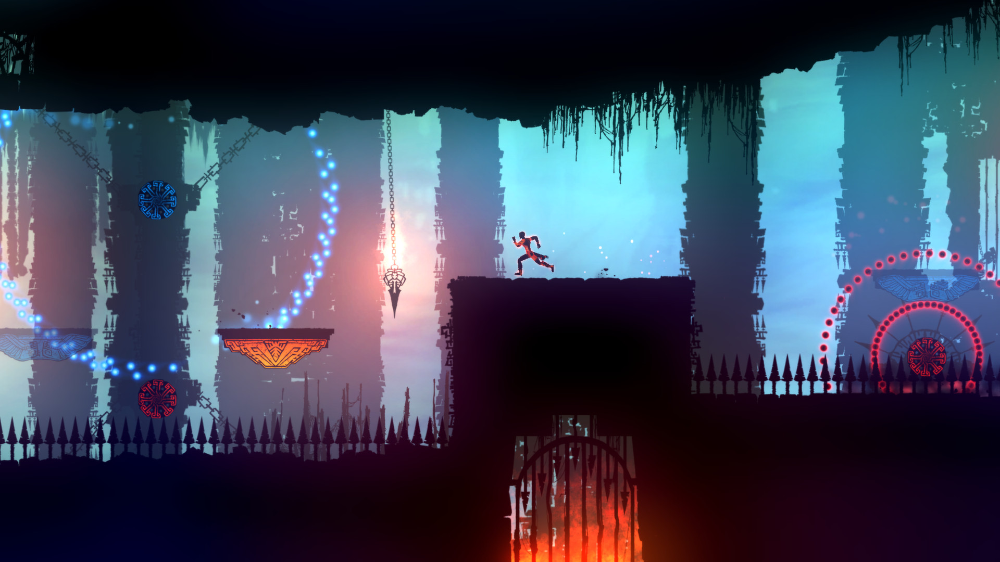

*참고한 게임 Outland의 플레이 화면(Steam 상점 스크린샷). 캐릭터는 지금 빨간색이고, 왼쪽에 파란 탄막, 오른쪽에 빨간 탄막이 함께 놓여 있습니다.*

| 항목 | 내용 |
|---|---|
| 엔진 · 언어 | Unity 6 (6000.3.15f1), URP 2D · C# |
| 사용한 패키지 | Input System(키 입력), uGUI + TextMeshPro(화면 UI) |
| 외부 에셋 | 캐릭터·보스·타일·배경·UI 그림과 Super Pixel Projectiles Pack 1(untiedgames, 보스 총알 그림). 모두 구매 또는 무료 에셋 |
| 레벨 제작 | 발판 틀(프리팹)을 씬에 직접 배치 (맵 편집 도구 LDtk는 초기에 쓰다가 07.01에 맵 파일을 지움) |
| 도구 | JetBrains Rider, Git · GitHub, Claude(→ [9장 AI와 함께 만든 방식](#ai와-함께-만든-방식)) |
| 기간 · 인원 | 2026.06.24 \~ 07.10 (07.07 완성, 07.10 정리) · 1인 |
| 규모 | 직접 쓴 C# 스크립트 33개(약 1,900줄, 배운 코드 제외), 씬 4개 |

- GitHub: https://github.com/rlawlsdn77/Unity-2D-Shifter

---

## 2. 한 판의 흐름

메뉴에서 시작해 STAGE 1 → STAGE 2 → 보스전을 차례로 지나면 한 판이 끝납니다. 각 스테이지 끝의 포탈에서 W를 누르면 다음 씬으로 넘어가고, 보스를 쓰러뜨린 뒤의 포탈은 메뉴로 돌아갑니다. 스테이지마다 HP 100, 회색에서 새로 시작합니다.

| STAGE 1 | STAGE 2 | STAGE BOSS |
|---|---|---|
|  |  |  |
| 레드 타일, 흰·검 총알 발사기, 박스 운반, 전구 퍼즐 | 움직이는 발판, 거울로 꺾는 레이저 퍼즐, 밀려오는 흰·검 벽(크러셔 벽) | 보스 **AGIS - RED MARTYR**. 공격 3번 뒤 5초 동안 드러나는 약점을 위에서 밟아 3번 맞히면 격파 |


*STAGE 2, 흰색 상태. 왼쪽 위에 지금 색, 아래에 HP 바가 있습니다. 캐릭터가 선 회색 돌 모양이 흰 발판이고, 오른쪽에 반투명하게 보이는 어두운 발판은 지금 색으로는 밟을 수 없는 검은 발판입니다.*

플레이어가 되풀이하는 행동은 아래 고리입니다.

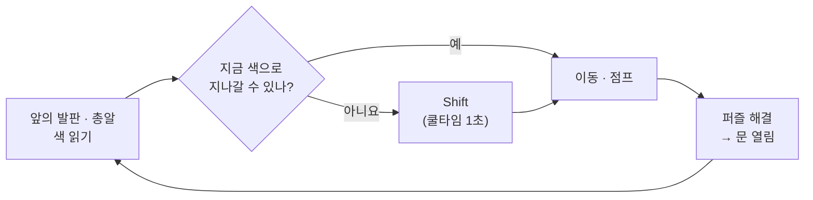

이 고리에서 Shift는 '길을 여는 열쇠'이자 '새 위험을 부르는 선택'입니다. 흰 발판을 밟으려고 흰색이 되는 순간 흰 총알에 맞을 수 있게 되므로, 플레이어는 **바꿀지와 언제 바꿀지**를 계속 고릅니다. 쿨타임 1초 때문에 바꾼 결정을 바로 되돌릴 수도 없습니다. 키 한 번의 결과가 화면 전체에 미치게 하려는 목표한 경험이 이 반복에서 나옵니다.

---

## 3. 전체 구조

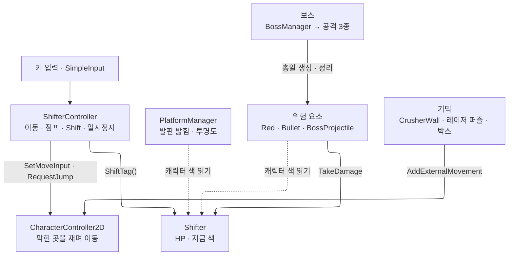

*실선은 직접 부르는 관계, 점선은 값을 읽기만 하는 관계입니다.*

코드는 아래 세 가지 원칙으로 나눴습니다. 기능이 늘어도 '색'과 '이동'이 엇갈리지 않게 하려는 것이었습니다.

1. **캐릭터의 색을 바꾸는 곳은 `Shifter.ShiftTag()` 하나.** 발판·총알·벽은 모두 캐릭터의 색을 읽기만 합니다. 바꾸는 곳이 하나라 서로 다른 색을 보는 일이 없습니다. → [4장](#4-색-규칙-shift-한-번이-바꾸는-것)
2. **캐릭터 이동은 `CharacterController2D`만 맡는다.** 키 입력도, 벽이 미는 힘도 이 코드를 거치며, 움직이기 전에 앞이 막혔는지 먼저 잽니다. → [5장](#5-거꾸로-쓰는-색-규칙-크러셔-벽), [7장](#7-캐릭터-이동과-카메라)
3. **보스 공격은 자기가 만든 총알을 스스로 치운다.** 보스 관리자는 공격에게 '시작'과 '정리'만 요청합니다. → [6장](#6-보스전)

| 클래스 | 맡는 일 |
|---|---|
| `ShifterController` | 키 입력 → 이동·점프 요청, Shift 쿨타임, 일시정지 |
| `Shifter` | HP와 HP 바, 색 바꾸기, 맞으면 깜빡임, 게임오버 |
| `CharacterController2D` (배운 코드 + 박스 밀기) | 막힌 곳을 재며 이동, 중력·2단 점프, 밖에서 미는 힘 |
| `PlatformManager` | 흰·검 발판의 밟힘과 투명도를 캐릭터 색에 맞춤 |
| `CrusherWall` · `BoxGoal` · `LightBeam` 등 | 스테이지 기믹 |
| `BossManager` · `IBossPattern` 구현 3종 | 공격 교체 · 그로기 · 사망 / 공격 하나의 실행과 정리 |

---

## 4. 색 규칙: Shift 한 번이 바꾸는 것

목표한 경험의 중심입니다. 키 한 번이 발판·총알·퍼즐을 함께 바꾸려면, 이 셋이 **같은 규칙 하나**를 따라야 했습니다.

### 4.1 같은 색이면 실체, 다른 색이면 허상

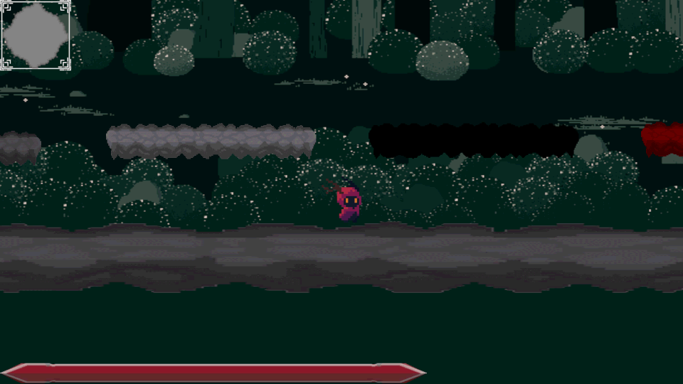

*STAGE 1 시작. 회색에서 Shift로 흰색이 되어 흰 발판에 올라서고, 검은색이 되면 그 발판이 꺼져 아래로 빠집니다. 검은 발판에 올라선 뒤 다시 흰색이 되면 또 빠집니다.*

| 대상 | 캐릭터와 같은 색 | 다른 색 |
|---|---|---|
| 흰·검 발판 | 밟힘 · 불투명 | 몸이 빠져나감 · 반투명(50%) |
| 회색·빨강 발판 | 항상 밟힘 | 항상 밟힘 (빨강은 닿아 있는 동안 HP가 깎임) |
| 총알 (STAGE 1 · 보스) | 맞음 | 몸을 지나감 |
| 크러셔 벽 (STAGE 2) | 지나감 | 밀려남 — 일부러 뒤집은 규칙 (→ [5장](#5-거꾸로-쓰는-색-규칙-크러셔-벽)) |

캐릭터는 회색으로 시작합니다. 회색은 흰·검 발판을 밟을 수 없지만 흰·검 총알에도 맞지 않는, '안전하지만 멀리 갈 수 없는' 상태입니다. 첫 Shift는 항상 흰색이고, 이후로는 흰색 ↔ 검은색만 오가며 회색으로 돌아가는 길은 없습니다.

회색으로 시작하게 한 것은 **Shift를 쓰게 하려는 것**입니다. 회색은 흰·검 어느 쪽과도 맞지 않아, 흰·검 발판은 밟을 수 없어 빠지고 크러셔 벽에는 모두 막혀 끌려갑니다. 한 번 Shift한 뒤 **회색으로 돌아갈 수 없게** 한 것은, 회색이 어떤 총알에도 맞지 않기 때문입니다. 돌아갈 수 있으면 무적 상태로 보스전을 진행할 수 있습니다.

Shift가 바꾸는 것은 캐릭터의 색 하나뿐이고, 발판·총알·벽·화면 표시는 각자 필요한 때에 그 색을 읽기만 합니다.

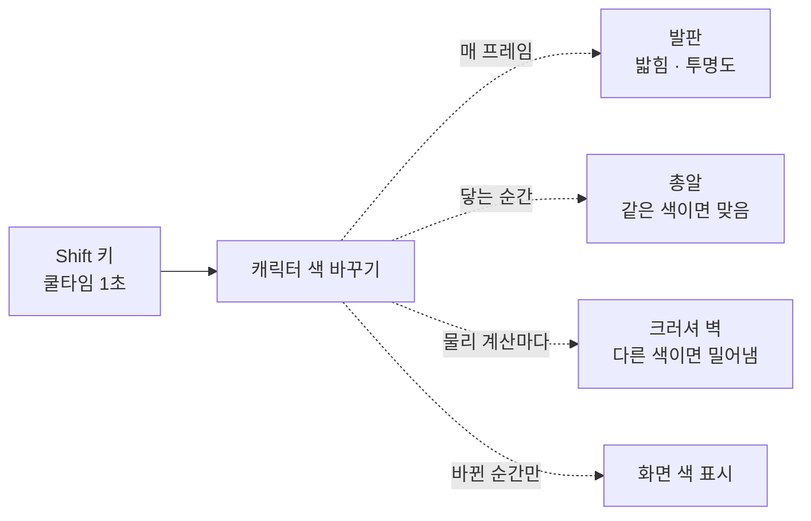

### 4.2 색을 바꾸고, 발판이 따라 바뀌는 코드

색은 Unity의 **태그**(오브젝트마다 하나씩 붙이는 이름표)로 나타냅니다. 캐릭터·발판·총알이 모두 `Common`·`White`·`Black` 중 하나를 달고, 판단은 "이름표가 같은가"(`CompareTag`) 하나로 합니다.

```csharp
// Shifter.cs — 흰색이면 검은색, 그 밖(회색 포함)은 흰색
public void ShiftTag()
{
    gameObject.tag = (gameObject.CompareTag(TAG_WHITE)) ? TAG_BLACK : TAG_WHITE;
    currentTag = gameObject.tag;
}

// PlatformManager.cs — 발판마다 캐릭터와 이름표를 비교해 부딪힘 상자를 켜고 끈다
private void ColliderControll()
{
    foreach (BoxCollider2D col in allColliders)
    {
        GameObject obj = col.gameObject;

        if (obj.CompareTag(TAG_COMMON) || obj.CompareTag(TAG_RED))
        {
            col.enabled = true;           // 무색: 항상 단단하다
        }
        else if (obj.CompareTag(player.tag))
        {
            col.enabled = true;           // 같은 색: 단단하다
        }
        else
        {
            col.enabled = false;          // 다른 색: 없는 것과 같다
        }
    }
}
```

- 다른 색 발판은 **콜라이더**(부딪힘을 판정하는 보이지 않는 상자)를 아예 끕니다. 이 선택 덕분에 레이저 퍼즐이 따로 코드 없이 같은 규칙을 따릅니다(4.3).
- 새 발판은 흰·검 발판 틀(프리팹)을 놓기만 하면 됩니다. `PlatformManager`가 이름표로 발판을 찾아 관리하므로, STAGE 2의 발판 20개(흰 9 · 검 11)를 코드 수정 없이 넣었습니다.

### 4.3 레이저 퍼즐: 꺼진 발판은 빛도 지나간다

STAGE 2의 레이저 퍼즐은 버튼을 밟으면 조준 모드가 되고, 마우스로 빛을 쏴 거울 3개에서 꺾어 센서에 맞히면 문이 열립니다. 조준하는 동안 캐릭터는 움직일 수 없지만 **Shift는 쓸 수 있습니다.** 제자리에서 색을 바꿔 빛이 지나갈 발판을 고르게 하려는 것입니다.

빛은 보이지 않는 선(**레이캐스트**: 한 점에서 선을 쏴 처음 맞는 물체를 찾는 기능)을 쏴서 계산합니다. 레이캐스트는 꺼진 콜라이더를 보지 못하므로, 다른 색 발판은 빛에게도 '없는 것'이 됩니다. 아래 빛 계산(`LightBeam.FireBeam`, 매 프레임)의 흐름에는 색을 확인하는 갈림길이 하나도 없습니다.

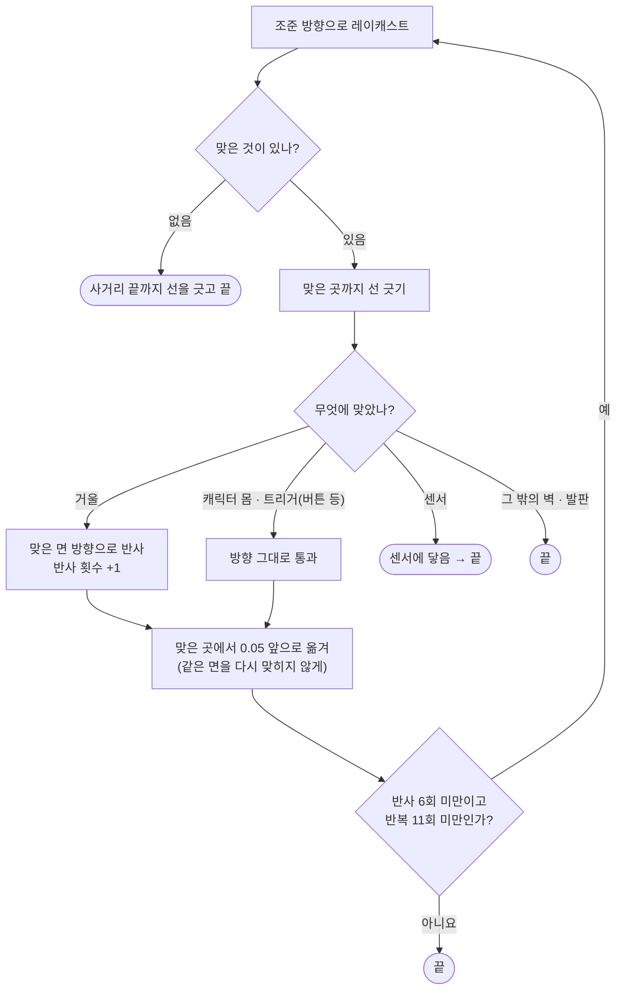

*센서에 닿았는지는 프레임마다 다시 계산해 센서(`LightSensor`)에 알립니다. 반사 횟수는 거울에서만 늘어나므로, 통과만 되풀이하는 경우를 위해 반복 횟수 상한을 따로 둡니다.*

| 검은색으로 수평 조준 | 흰색으로 같은 수평 조준 |
|---|---|
| 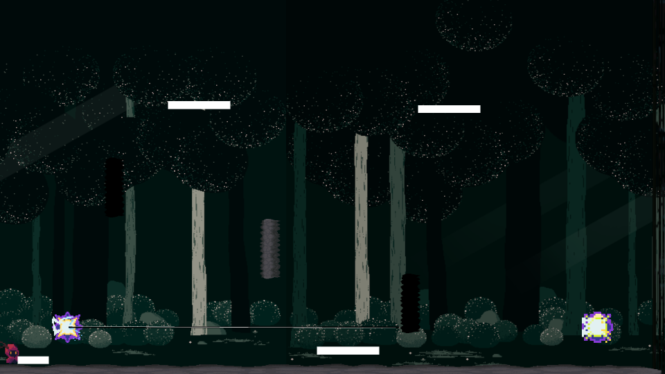 | 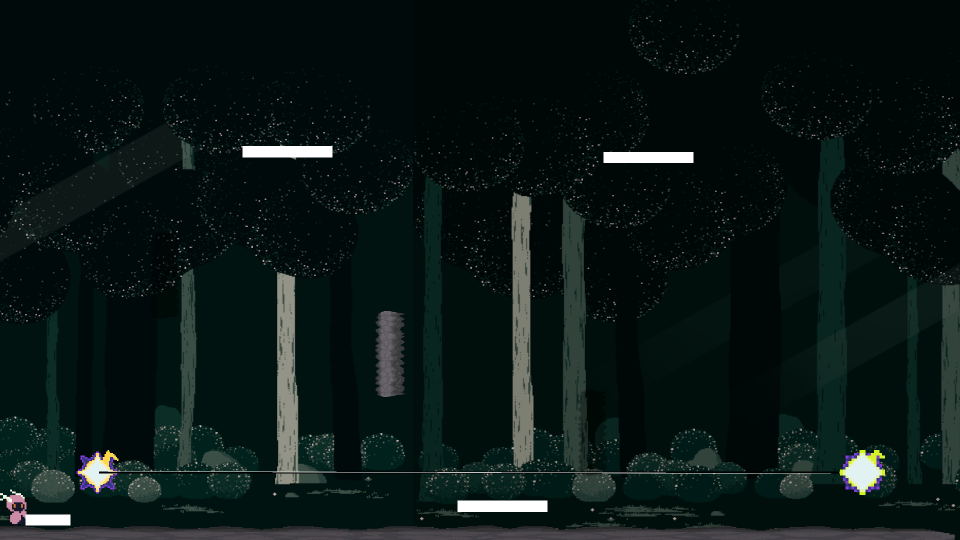 |

*같은 각도로 쏴도 색에 따라 결과가 다릅니다. 검은색이면 수평 빛이 검은 발판에 막히고(왼쪽), 흰색이 되면 그 검은 발판이 꺼져 빛이 센서까지 곧게 닿아 퍼즐이 풀립니다(오른쪽).*

오른쪽 직선 풀이는 **의도하지 않은 배치 실수**입니다. 의도한 풀이는 검은색으로 위쪽을 겨눠 거울 3개를 거치는 길이었습니다. 그런데 흰색이 되면 다른 색인 검은 발판이 콜라이더째 꺼지고, 빛이 그 자리를 그대로 지나갑니다. 모든 기능이 같은 규칙을 따르게 만들었기 때문에, 레벨을 만들 때 **그 규칙이 열어 주는 길까지** 확인했어야 했습니다. 아직 고치지 않은 문제로 [9장](#9-돌아보며)에 적었습니다.

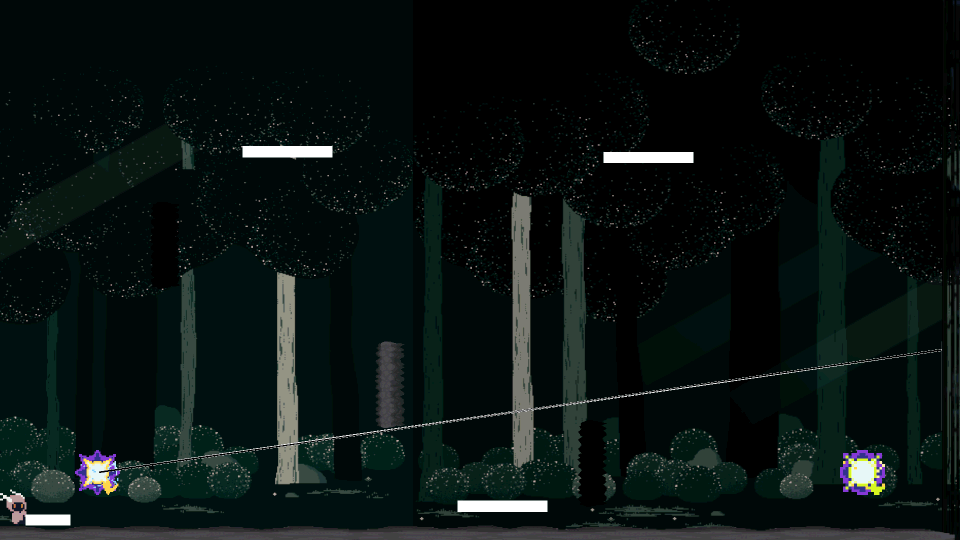

*의도한 풀이. 검은색으로 수평 조준하면 검은 발판에 막히고, 위로 옮기면 거울 3개를 거쳐 오른쪽 센서에 닿습니다.*

### 4.4 이름표로, 콜라이더째 끄기로 정한 이유

**결정 1. 색을 무엇으로 나타낼까?**

처음부터 태그로 만들었습니다. 아래 비교는 문서를 쓰며 정리한 것입니다.

| | 태그(이름표) | 색 값을 가진 부품을 따로 붙임 | 충돌 층(레이어)을 색마다 나눔 |
|---|---|---|---|
| 비교 | `CompareTag` 한 줄 | 부품을 찾아야 함(`GetComponent`) | 캐릭터가 부딪힐 층만 바꿈 |
| 발판 모으기 | 이름표로 한 번에 찾음 | 찾는 방법을 직접 만들어야 함 | 층으로 찾음 |
| 한계 | 오브젝트당 하나라 'Player' 이름표를 못 씀, 글자라 오타를 못 잡음 | 없음 | 이미 쓰는 '밟는 층(Tile)'과 겹침, 총알·투명도는 따로 만들어야 함 |

**태그를 골랐습니다.** 캐릭터·발판·총알이 **같은 글자 하나**로 비교되는 단순함이 "같은 색인가"라는 게임 규칙과 그대로 맞았습니다. 대가로 캐릭터가 'Player' 이름표를 달 수 없어 오브젝트 이름 `"Shifter"`로 캐릭터를 알아보게 됐습니다(6개 파일 7곳). 이 대가는 [9장](#9-돌아보며)의 회고로 이어집니다.

**결정 2. 다른 색 발판을 어떻게 '없는 것'으로 만들까?**

| | 발판의 콜라이더를 끔 | 캐릭터 쪽에서 '무엇에 부딪힐지'만 바꿈 |
|---|---|---|
| 바꾸는 것 | 발판 수만큼 켜고 끔 | 캐릭터 설정 값 하나(`collisionLayer`) |
| 미치는 범위 | 캐릭터 이동, 레이저 등 콜라이더를 보는 **모든 기능** | 캐릭터 이동뿐 |
| 대가 | 콜라이더가 꼭 필요한 것(총알, 크러셔 벽)은 관리 대상에서 빼야 함 | 레이저처럼 새 기능마다 같은 규칙을 다시 만들어야 함 |

**발판의 콜라이더를 끄기로 했습니다.** 06.25 첫 구현 때 두 방법을 견줘, 나중에 만들 기능도 콜라이더를 보기만 하면 같은 색 규칙을 따르도록 이쪽을 골랐습니다. 그래서 2주 뒤 만든 레이저 퍼즐(07.07)이 **추가 코드 없이** 색 규칙을 따랐습니다. 조준 중에 Shift로 빛의 길을 열고 닫는 기믹이 여기서 생겼습니다. 같은 이유로 흰색 직선 풀이도 생겼습니다.

**결정 3. 레이저 경로를 어떻게 계산할까?**

| | 빛 알갱이(총알 같은 물체)를 날려 물리 반사에 맡김 | 매 프레임 레이캐스트로 경로를 이어 붙임 |
|---|---|---|
| 보이는 방식 | 날아가는 동안만 보임, 조준을 바꾸면 다시 날려야 함 | 마우스를 움직이는 즉시 전체 경로가 보임 |
| 결과 | 속도·충돌 정밀도에 따라 흔들림 | 같은 각도면 늘 같은 경로 |
| 대가 | 없음 | 반사·통과 규칙, 같은 면 재충돌, 끝없는 반복을 직접 막아야 함 |

**레이캐스트를 골랐습니다.** 조준 퍼즐은 '이 각도면 어디에 맞는가'가 바로 보여야 한다고 판단했습니다. 같은 면을 다시 맞히는 문제는 0.05 앞에서 다시 쏘는 것으로, 끝없는 반복은 반사 6회·반복 11회 상한으로 막았습니다. 그리고 레이캐스트가 콜라이더를 보기 때문에 결정 2의 효과가 레이저까지 그대로 닿았습니다.

### 4.5 예외 상황

| 상황 | 처리 |
|---|---|
| 쿨타임(1초) 중 Shift | 무시 |
| 레이저 조준 중 Shift | 허용. 이동만 막고 Shift는 받음 |
| 흰·검 이름표지만 발판이 아닌 것(크러셔 벽, 보스 총알) | 물리 몸체(`Rigidbody2D`)가 있으면 `PlatformManager`가 건너뜀 (→ 5.4) |
| 이미 풀린 레이저 퍼즐의 버튼을 다시 밟음 | 무시. 한 번 풀리면 빛이 벗어나도 문은 열려 있음 |
| 다른 색 발판을 지나는 도중 Shift | **처리 없음.** 다시 켜진 발판 안에 갇혀, 1초 뒤 다시 Shift해야 풀림 (→ [9장](#9-돌아보며)) |

---

## 5. 거꾸로 쓰는 색 규칙: 크러셔 벽

크러셔 벽은 발판에서 익힌 색 규칙을 거꾸로 써서, **Shift를 누르는 판단과 타이밍**을 다시 과제로 만든 STAGE 2의 마지막 구간입니다. 벽이 캐릭터를 미는 동작은, 엔진의 자동 물리를 쓰지 않는 이 게임의 캐릭터(→ [7장](#7-캐릭터-이동과-카메라))에서는 직접 만들어야 했습니다.

### 5.1 STAGE 2를 크러셔 벽으로 바꾼 이유

STAGE 2는 처음(07.06) **흰·검 총알 개수를 세는 퍼즐**로 만들고 있었습니다. 다음 날(07.07) 이것을 지금의 레이저 퍼즐과 크러셔 벽으로 바꿨습니다.

| | 흰·검 총알 개수 세기 (07.06) | 레이저 퍼즐 + 크러셔 벽 (07.07) |
|---|---|---|
| 플레이어가 하는 일 | 지나가는 총알을 보고 개수를 셈 | 빛의 길을 고르고, 밀려오는 벽마다 색을 맞춤 |
| Shift의 역할 | 거의 없음 | 조준 중 길 바꾸기, 벽마다 통과할 색 고르기 |

**Shift를 쓸 이유가 약해서 바꿨습니다.** 개수 세기는 관찰과 기억의 퍼즐이라, 이 게임의 중심인 '색을 바꾸는 판단'이 끼어들 자리가 없었습니다.

크러셔 벽은 1.2초마다 흰색 또는 검은색 벽이 초당 10유닛으로 밀려오는 구간입니다. 발판과 규칙을 **반대로** 했습니다. 벽과 **같은 색이면 몸이 지나가고, 다른 색이면 벽에 걸려 끝 지점까지 끌려갑니다.** 발판에서 익힌 "같은 색 = 단단함"을 마지막 구간에서 거꾸로 쓰게 하는 변주입니다. 바닥은 레드 타일입니다.

벽도 발판처럼 캐릭터와 다른 색이면 반투명하게 보입니다. 반투명은 **'내 색과 다르다'**는 표시라, 발판에서는 '지나갈 수 있다', 벽에서는 '막힌다'는 뜻이 됩니다.

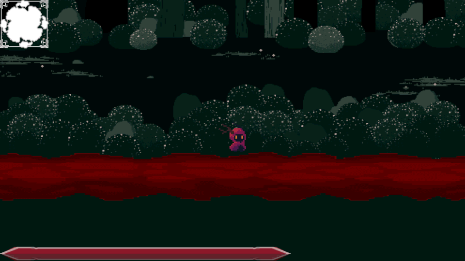

*흰 벽에 밀리다가 Shift로 흰색이 되면 벽이 몸을 지나가고, 다음 검은 벽도 색을 맞춰 통과합니다.*

처음 코드 기본값(속도 3 · 간격 0.7초)에서는 벽이 느려 피해 달아날 수 있었습니다. Shift를 적극적으로 써서 기믹을 풀게 하려고, 벽을 캐릭터(초당 8)보다 빠른 초당 10으로 바꿔 **도망칠 수 없게** 했습니다. 간격 1.2초와 쿨타임 1초(코드 기본값 2초)도 플레이해 보며 맞춘 값이라, 쿨타임이 벽 간격보다 짧아 벽마다 색을 맞출 수는 있습니다.

### 5.2 문제 해결: 벽과 겹치면 캐릭터가 얼어붙던 문제 (07.07)

- **문제.** 처음에는 벽을 물리 물체(Dynamic)로 두고 물리로 밀어 보았지만, 캐릭터는 물리 힘을 받지 않는 키네마틱이라 결국 캐릭터 위치를 직접 옮겨야 했습니다. 그래서 벽의 콜라이더를 켜 두고 이동 코드에 막힘을 맡겼습니다. 그런데 벽이 움직여 캐릭터와 겹치는 순간, 캐릭터가 벽 속에서 꼼짝하지 못했습니다.
- **원인.** 처음에는 Shift로 콜라이더가 켜지고 꺼지는 것과 관련이 있는지 AI에게 물었고, AI가 원인을 짚었습니다. 캐릭터는 움직이기 전에 '가려는 방향으로 상자를 밀어 보아' 부딪히는지 잽니다(→ 7.2의 `ResolveAxisMovement`). 이미 겹쳐 있으면 어느 방향으로 재도 '바로 앞이 막힘'(거리 0)이 나와, 움직일 수 있는 거리가 늘 0이 됩니다. 이 이동 코드에는 겹침을 풀어 주는 처리가 없습니다. 로그를 찍어 보니 벽에 있는 동안 계속 같은 값이 나와, 이 원인이 맞다는 것을 확인했습니다.
- **해결.** 벽의 콜라이더를 끄고, 겹침을 직접 확인해 벽이 움직인 만큼 캐릭터를 옮기는 방식(5.4)으로 바꿨습니다.
- **결과.** 플레이로 확인했습니다. 다른 색 벽에 걸리면 벽과 함께 끝 지점까지 밀려가고, 그 사이 Shift로 같은 색이 되면 그 자리에서 벽이 몸을 지나갑니다(5.1 GIF).

### 5.3 벽 콜라이더를 끄고 직접 민 이유

**크러셔 벽과 캐릭터의 충돌을 어떻게 처리할까?** 실제로 해 본 순서대로 적습니다.

| | 벽을 물리 물체(Dynamic)로 두고 물리로 밀기 | 벽 콜라이더를 켜고 이동 코드에 맡김 | 벽 콜라이더를 끄고 겹침을 직접 확인해 밀기 |
|---|---|---|---|
| 추가 코드 | 적음 | 없음 | 겹침 확인 + 미는 양 계산 |
| 문제 | 캐릭터는 물리 힘을 받지 않아(키네마틱) 결국 위치를 직접 옮겨야 함 | 겹치는 순간 캐릭터가 얼어붙음 (5.2) | 그림 사각형으로 겹침을 보므로 단순한 모양에만 맞음. 물리 몸체 우회가 필요 |

**세 번째를 골랐습니다.** 이동 판정을 `CharacterController2D`가 쥐고 있는 구조에서는 **캐릭터 이동을 그 코드 하나에 모으는 것**이 가장 안전하다고 판단했습니다. 이동 코드가 하나면 어떤 힘이 더해져도 같은 막힘 검사를 거칩니다.

### 5.4 크러셔 벽: 부딪힘 판정 없이, 벽이 움직인 만큼 민다

```csharp
// CrusherWall.cs (발췌) — 물리 계산마다, 벽 하나씩
bool blocked = !player.CompareTag(wall.obj.tag);     // 다른 색이면 막힌다 (발판과 반대)
color.a = blocked ? 0.5f : 1f;                       // 다른 색 벽은 반투명 (5.1)

// ... 벽을 끝 지점 쪽으로 옮기고, 이번에 움직인 거리를 wallDelta에 담는다

if (blocked && wall.renderer.bounds.Intersects(playerCollider.bounds))
{
    playerController.SetMoveInput(0f);
    playerController.AddExternalMovement(wallDelta);  // 벽이 움직인 만큼 캐릭터도 움직인다
}

// SpawnWall() — 벽을 만들 때
col.enabled = false;                                 // 켜 두면 캐릭터가 벽 속에서 얼어붙는다 (5.2)
Rigidbody2D rb = obj.AddComponent<Rigidbody2D>();    // PlatformManager가 이 벽을 발판으로 관리하지 않게
```

- **겹침은 그림의 사각형으로 직접 확인합니다.** 콜라이더를 끈 대신, 벽 그림과 캐릭터가 겹치면 벽이 이번에 움직인 거리(`wallDelta`)만큼 캐릭터를 밀어 줍니다.
- **미는 힘도 이동 코드를 거칩니다.** `AddExternalMovement`는 미는 거리를 더해 둘 뿐이고, 실제 이동은 `CharacterController2D`가 앞이 막혔는지 잰 뒤에 합니다(→ 7.2). 그래서 밀려난 캐릭터가 다른 지형을 뚫지 않습니다.
- **물리 몸체를 붙이는 이유.** 벽은 흰·검 발판 틀을 세워 다시 씁니다. 그대로 두면 `PlatformManager`가 이름표를 보고 콜라이더를 다시 켜므로, '물리 몸체가 있으면 건너뛴다'는 규칙에 걸리게 했습니다.

---

## 6. 보스전

보스전에서는 쏟아지는 흰·검 총알 속에서 '어느 색이 될지'를 계속 고르다가, 보스가 멈춘 5초 안에 약점을 밟습니다. 색 판단을 가장 빠르게 반복하는 구간입니다. 스테이지에서 익힌 Shift 활용법으로, 탄막을 알맞은 타이밍에 Shift로 피한 뒤 약점을 공격하게 했습니다.

### 6.1 공격 3번 → 5초 빈틈 → 약점

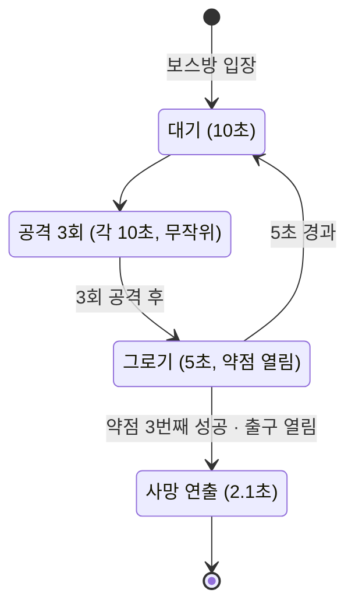

보스는 10초마다 공격을 무작위로 바꾸고, 3번 공격한 뒤 5초 동안 멈춰 약점을 드러냅니다(**그로기**). 약점은 밟는 즉시 꺼져 그로기 한 번에 한 번만 맞힐 수 있습니다. 한 주기가 45초(대기 10 + 공격 30 + 그로기 5)이므로, 가장 빠른 격파는 세 번째 그로기가 열리는 **약 130초(2:10)** 입니다(코드의 시간 값으로 계산).

| 공격 | 내용 | 피해 |
|---|---|---|
| 운석 (Eruption) | 보스 위 10유닛, 좌우 ±8 범위의 무작위 위치에서 1초마다 하나씩 떨어짐. 15개로 정했지만 10초 뒤 다음 공격으로 넘어가며 끊겨 실제로는 약 10개 | 10 |
| 난사 (Rampage) | 보스 중심에서 8방향으로 한꺼번에 쏘기를 1.5초 간격으로 5번 (40발) | 6 |
| 레이저 (Razer) | 캐릭터 방향 ±15° 안의 무작위 각도로 6\~12발, 0.7초 간격 | 8 |

- 총알마다 흰·검이 무작위로 정해지고, 같은 색일 때만 맞습니다. 흰·검 발판은 총알을 막지 않으므로, 발판 뒤에 숨는 대신 **다가오는 총알과 다른 색이 되어 몸으로 흘려보내는** 것이 회피 방법입니다.
- 개수·간격·속도는 보스 프리팹 기본값(운석 5개, 난사 3번, 레이저 5\~10발·속도 12 등)에서 **플레이해 보며 난이도를 맞춘 값**입니다.

| 운석 | 난사 | 레이저 |
|---|---|---|
| 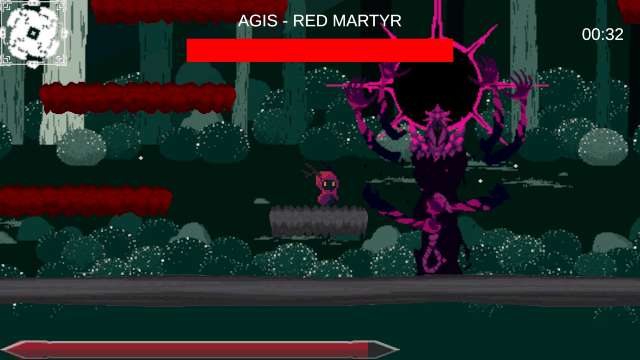 | 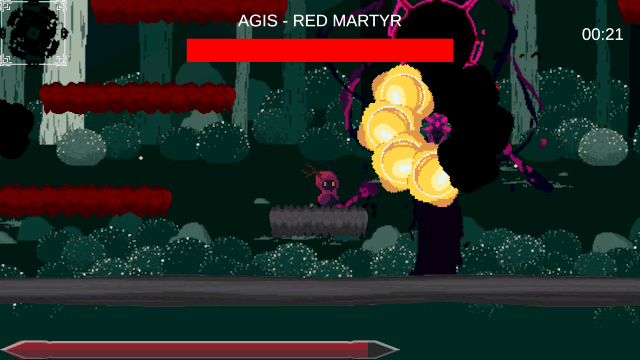 | 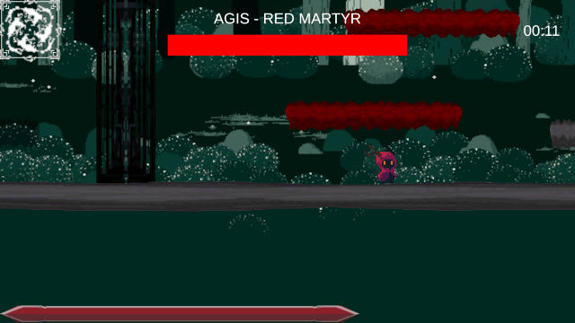 |

*공격 3종. 레이저는 보스 앞에서는 쏘자마자 사라지는 버그(→ [9장](#9-돌아보며)) 때문에, 보스에서 떨어진 자리에서 찍어 레이저가 화면을 가로지르는 모습입니다. 흰 총알은 그림의 원래 색 때문에 노란빛으로 보입니다.*

### 6.2 보스전을 이루는 클래스

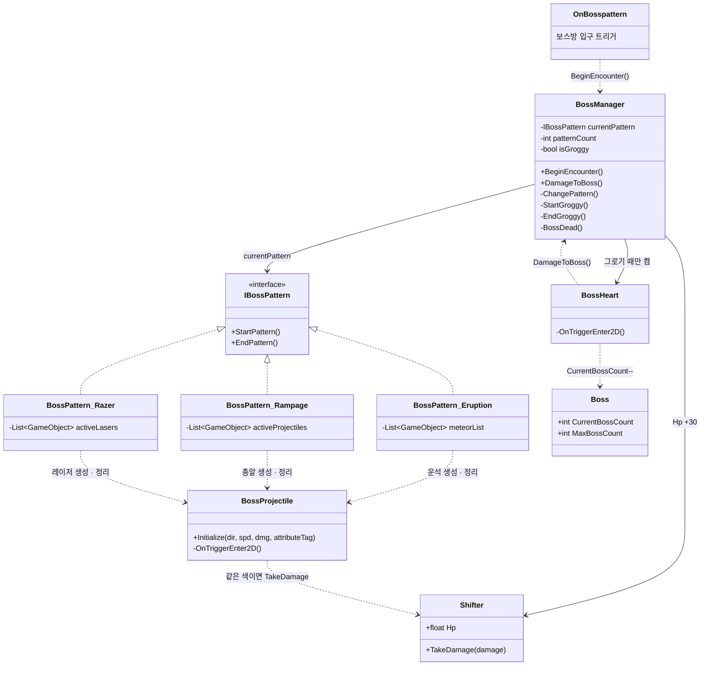

*실선은 필드로 들고 있는 관계, 점선은 부르거나 만드는 관계입니다. `BossManager`는 공격을 `IBossPattern`으로 다루지만, 공격을 고를 때는 세 공격 클래스를 직접 들고 `switch`로 고릅니다(→ 6.4 결정 1).*

### 6.3 공격 교체와 그로기

```csharp
// BossManager.cs (발췌)
private void ChangePattern()
{
    if (currentPattern != null)
    {
        currentPattern.EndPattern();                // (1) 이전 공격은 스스로 정리
    }

    patternCount++;
    if (patternCount > 3)                           // (2) 3번 뒤 그로기
    {
        StartGroggy();
        return;
    }

    int randomPattern = Random.Range(0, 3);
    switch (randomPattern)
    {
        case 0: StartEruptionPattern(); break;      // 각 함수: 애니메이션 신호 + currentPattern 지정 + StartPattern()
        case 1: StartRazerPattern(); break;
        case 2: StartRampagePattern(); break;
    }
}

private void StartGroggy()
{
    if (isGroggy) return;
    isGroggy = true;
    patternCount = 0;

    if (currentPattern != null)
    {
        currentPattern.EndPattern();
        currentPattern = null;
    }

    ForceIdleAnimation();                           // (3) 남은 공격 신호를 지우고 바로 서 있는 동작으로
    bossHeart.gameObject.SetActive(true);           // 약점 열기
    Invoke(nameof(EndGroggy), 5f);                  // 5초 뒤 자동 해제
}

private void ForceIdleAnimation()
{
    bossAnimator.ResetTrigger(ANIM_ATK1_ERUPTION);
    bossAnimator.ResetTrigger(ANIM_ATK2_RAMPAGE);
    bossAnimator.ResetTrigger(ANIM_ATK3_RAZER);
    bossAnimator.Play(ANIM_IDLE_STATE);
}
```

1. **정리는 공격이 스스로.** `BossManager`는 무엇이 남았는지 모른 채 '정리해라'(`EndPattern`)만 부릅니다. 운석 15개 중 10개째를 만들던 중이어도 남은 작업과 떨어지던 운석이 함께 사라집니다.
2. **그로기 중에는 공격 시계가 멈춥니다.** 그로기가 끝나면 다시 10초를 세므로 6.1의 '대기 10초'가 생깁니다.
3. **애니메이션 신호는 쓰일 때까지 남습니다.** 그로기 직전에 걸린 공격 신호(트리거)가 남아 있으면, 서 있는 동작으로 돌아오자마자 공격 동작이 나옵니다. 그래서 신호 3개를 지우고 서 있는 동작을 바로 재생합니다.

공격 하나는 '시작'과 '정리' 두 함수만 약속하는 **인터페이스**(`IBossPattern`: 이 함수들을 꼭 갖추겠다는 약속)를 구현합니다.

```csharp
// IBossPattern.cs
public interface IBossPattern
{
    void StartPattern();
    void EndPattern();
}

// BossPattern_Rampage.cs (발췌) — 만든 총알을 목록에 담아 두고, 끝날 때 남은 것을 모두 지운다
public void StartPattern()
{
    activeProjectiles.Clear();
    StartCoroutine(RampageRoutine());
}

public void EndPattern()
{
    StopAllCoroutines();                            // 아직 쏘지 않은 발사도 취소
    foreach (var projectile in activeProjectiles)
    {
        if (projectile != null) Destroy(projectile);   // 이미 맞아서 사라진 총알은 null
    }
    activeProjectiles.Clear();
}
```

약점은 그로기 때만 켜지고, **위에서 밟을 때만** 인정합니다.

```csharp
// BossHeart.cs
private void OnTriggerEnter2D(Collider2D collision)
{
    if (collision.gameObject.name != "Shifter") return;
    if (collision.transform.position.y <= transform.position.y) return;   // 옆·아래에서 닿으면 무시

    boss.CurrentBossCount--;
    bossManager.DamageToBoss();                     // 캐릭터 HP +30, 보스 체력이 0이면 사망 연출
    gameObject.SetActive(false);                    // 그로기 한 번에 한 번만
}
```

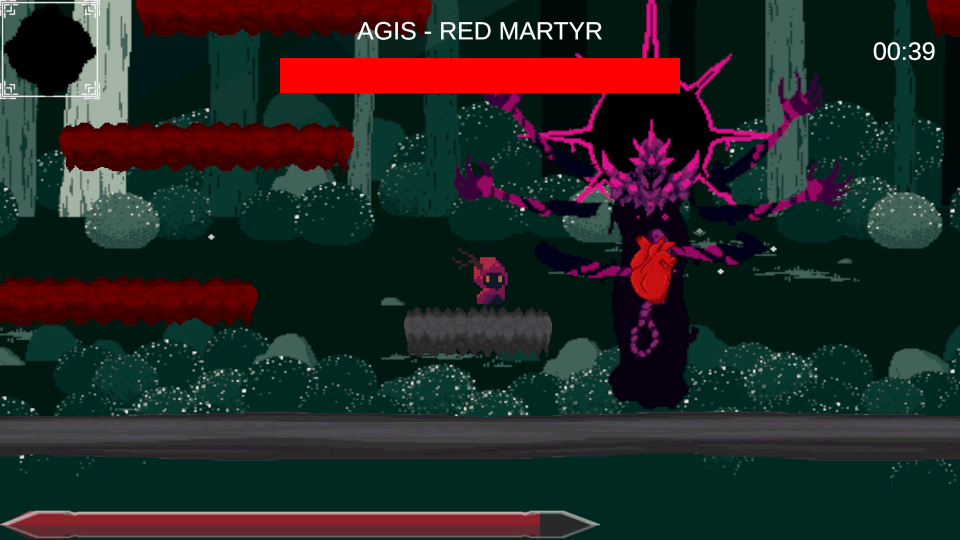

*첫 그로기(입장 후 40초). 보스 앞 발판에서 2단 점프로 약점을 밟자 보스 체력 바가 한 칸 줄어듭니다(3 → 2).*

### 6.4 인터페이스로 묶고 랜덤 발판을 뺀 이유

**결정 1. 공격 3종의 공통 구조: 부모 클래스 vs 인터페이스**

| | 공통 부모 클래스(추상 클래스) `BossPattern` | 약속만 정하는 인터페이스 `IBossPattern` |
|---|---|---|
| 공유하는 것 | 동작(총알 목록, 정리 반복문)을 부모에 한 번만 | 약속(시작하면 끝낼 수 있어야 한다)만 |
| 이 게임에서 | 세 공격의 공통점은 시작·정리뿐이고 공격 방식(낙하, 원형 발사, 조준 발사)이 모두 달라 부모가 가질 동작이 거의 없음 | `BossManager`는 두 함수만 알면 되고, 공격은 방식을 자유롭게 구현 |
| 대가 | 없음 | '총알을 목록에 담고 정리 때 지우기'가 세 공격에 똑같이 반복됨 |

**인터페이스로 정했습니다.** 처음에는 빈 `BossPattern` 클래스로 시작했다가(07.01) 지우고, 공격을 실제로 구현할 때(07.06) 인터페이스로 바꿨습니다. 공격끼리 나눠 가질 것은 동작이 아니라 **약속**이라고 봤기 때문입니다. 정리 코드 반복은 3곳 × 8줄 정도라 감수했습니다. 다만 `BossManager`가 아직 공격의 실제 타입을 `switch`로 알고 있어, 새 공격을 넣으려면 `BossManager`도 고쳐야 합니다.

**결정 2. 보스전 랜덤 발판을 유지할까, 걷어낼까?**

07.06에 '공격이 바뀔 때마다 보스 주변(반경 2\~6) 무작위 위치에 흰·검 무작위 발판 5개를 만드는' 기능을 넣었습니다. 보스전에서도 Shift로 발판을 골라 밟게 하려는 것이었습니다.

| | 유지하고 생기는 위치를 검사함 | 기능을 빼고 고정 지형에서 싸움 |
|---|---|---|
| 좋은 점 | 보스전에도 발판을 골라 밟는 재미가 남음 | 캐릭터가 갇히는 상황이 아예 없음 |
| 대가 | 좁은 보스방에서 '서로·캐릭터와 겹치지 않고, 닿을 수 있는' 위치를 찾는 규칙과, 못 찾았을 때의 처리가 필요 | 보스전이 총알 피하기 중심이 됨 |

**기능을 뺐습니다(07.10).** 직접 플레이하다가 발판 속에 갇히는 일을 겪었습니다. 발판이 좁은 곳에 겹쳐 생기거나, **흰·검 발판이 둘 다 캐릭터 자리에 생기면 빠져나갈 방법이 없었습니다.** 겹친 콜라이더 안에서는 움직일 수 없고(5.2와 같은 원인), 어느 색으로 바꿔도 둘 중 하나는 켜져 있기 때문입니다. 실력으로 피할 수 없는 실패가 무작위로 생기는 것은 공정하지 않다고 판단했습니다. 이 결정으로 `BossManager`에서 67줄을 지웠습니다.

### 6.5 예외 상황

| 상황 | 처리 |
|---|---|
| 보스방 입구를 다시 지나감 | 이미 시작했으면 무시 |
| 공격 도중 다음 공격 · 그로기 · 사망 | `EndPattern`이 진행 중인 작업을 멈추고 남은 총알을 지움 |
| 총알이 이미 맞아서 사라짐 | 목록의 빈칸(null)은 건너뜀 |
| 아무것도 맞히지 못한 총알 | 10초 뒤 스스로 사라짐 |
| 약점을 옆이나 아래에서 건드림 | 무시 (캐릭터와 약점의 높이 비교) |
| 그로기 중 사망 | 5초 뒤로 예약한 그로기 해제(`EndGroggy`)를 취소 |

---

## 7. 캐릭터 이동과 카메라

발판이 켜지고 꺼지는 게임에서는 점프가 늘 같은 높이·같은 거리로 나가야 플레이어가 '색 판단'에만 집중할 수 있습니다. 카메라는 떨어질 곳을 먼저 보여 줘 그 판단을 돕습니다.

### 7.1 물리 엔진 대신 키네마틱 이동을 고른 이유

캐릭터 이동은 강의에서 배운 `CharacterController2D`를 썼습니다. 이 코드는 **키네마틱 이동**, 즉 엔진의 자동 물리(중력·밀림)에 맡기지 않고 코드가 매번 위치를 직접 정하는 방식입니다.

| | 물리 엔진이 움직임 (Dynamic Rigidbody) | 코드가 위치를 정함 (키네마틱 `CharacterController2D`) |
|---|---|---|
| 조작감 | 힘·마찰로 움직여 멈출 때 미끄러지고, 점프 높이가 상황에 따라 흔들림 | 키를 떼면 바로 서고, 점프 높이가 늘 같음 |
| 발판이 켜지고 꺼질 때 | 켜진 콜라이더와 겹치면 물리 엔진이 캐릭터를 튕겨 냄 | 튕겨 내지 않음 |
| 밀기 · 밀리기 | 저절로 생김 | 모두 직접 만들어야 함 (→ 5장 · 8장) |

**키네마틱 이동을 골랐습니다.** 흰·검 발판 사이를 정확히 뛰어야 하는 게임이라 미끄러짐 없는 조작감이 필요했고, Shift로 발판 콜라이더가 수시로 켜지고 꺼질 때 물리 엔진이 캐릭터를 튕겨 내지 않는 안정성이 중요했습니다. 대가로 박스 밀기(8장)와 크러셔 벽의 밀림(5장)을 직접 만들었고, 겹친 상태를 풀어 주는 처리는 아직 없습니다.

### 7.2 캐릭터 이동

```csharp
// CharacterController2D.cs (발췌) — 입력과 밖에서 민 양을 합친 뒤, 가로·세로를 따로 재서 막힌 거리까지만 옮긴다
private void FixedUpdate()
{
    IsGrounded = CheckGrounded();
    ApplyGravity();
    ApplyJump();

    Vector3 desireMove =
        new Vector3(moveInput * speed, VerticalVelocity) * Time.fixedDeltaTime
        + externalDelta;                                        // 크러셔 벽이 민 양도 여기서 합쳐진다
    externalDelta = Vector3.zero;

    Vector3 moveVector = Vector3.zero;
    moveVector.x = ResolveAxisMovement(desireMove.x, Vector3.right);
    moveVector.y = ResolveAxisMovement(desireMove.y, Vector3.up);

    if (moveVector.y != desireMove.y) VerticalVelocity = 0.0f;  // 바닥·천장에 막히면 세로 속도 0

    rBody.MovePosition(transform.position + moveVector);
}

private float ResolveAxisMovement(float move, Vector3 axis)
{
    if (move == 0.0f) return 0.0f;

    Vector3 dir = (move > 0.0f ? axis : -axis);
    float distance = Mathf.Abs(move);
    Bounds box = GetCastBox();                                  // 콜라이더보다 살짝 작은 상자

    RaycastHit2D hit = Physics2D.BoxCast(
        box.center, box.size, 0.0f, dir, distance, collisionLayer);
    if (hit.collider == null) return move;

    // (가로로 막혔을 때 박스 밀기 — 8장)

    float allowed = Mathf.Max(0, hit.distance - skinWidth);     // 이미 겹쳐 있으면 0 → 얼어붙음 (5.2)
    return Mathf.Sign(move) * allowed;
}
```

- 움직이기 전에 캐릭터 크기의 상자를 가려는 방향으로 밀어 보고(**BoxCast**), 부딪히기 직전까지만 움직입니다. 가로와 세로를 따로 재므로 벽에 붙어도 떨어지고, 바닥 위에서도 걷습니다.
- 크러셔 벽이 미는 양(`externalDelta`)도 키 입력과 합쳐져 같은 검사를 거칩니다. 3장 원칙 2의 실체가 이 함수입니다.
- 수치: 속도 8, 중력 −24, 점프력 11, 2단 점프.

### 7.3 문제 해결: 왼쪽을 보면 충돌 범위가 그림과 어긋나던 문제 (07.01)

- **문제.** 왼쪽으로 이동하면 캐릭터 그림은 뒤집히는데, 벽·발판에 닿는 위치는 오른쪽을 볼 때 그대로라 그림과 달랐습니다. 발판 왼쪽 끝에서는 그림이 허공에 나가 있는데도 서 있고, 오른쪽 끝에서는 그림이 발판 위에 있는데도 떨어졌습니다.
- **원인.** 좌우 반전을 그림이 붙은 **자식** 오브젝트에만 했습니다. 콜라이더는 부모(`Shifter`)에 있어 뒤집히지 않았고, 이 콜라이더가 중심에서 오른쪽으로 0.265 치우쳐 있어 차이가 그대로 드러났습니다.
- **해결.** 부모째 좌우로 뒤집어 그림과 콜라이더가 함께 뒤집히게 했습니다.

```csharp
// ShifterController.cs — 07.01 수정
// 전: animator.transform.localScale = new Vector3(FacingDirection, 1, 1);   // 그림(자식)만 뒤집힘
transform.localScale = new Vector3(FacingDirection, 1, 1);                    // 부모째 뒤집어 콜라이더도 함께
```

- **결과.** 플레이로 확인했습니다. 왼쪽을 보고 벽·발판에 붙어도 그림과 닿는 위치가 맞습니다.

### 7.4 카메라: 위는 넓게, 아래는 좁게

캐릭터가 조금 움직일 때마다 화면이 흔들리지 않도록, 카메라가 따라가지 않는 구역(**데드존**)을 두고 캐릭터가 그 밖으로 나간 만큼만 따라갑니다.

```csharp
// CameraController.cs (발췌)
void LateUpdate()
{
    if (player == null) return;

    float deltaX = player.position.x - targetX;
    if (Mathf.Abs(deltaX) > horizontalDeadZone)
    {
        targetX += deltaX - (Mathf.Sign(deltaX) * horizontalDeadZone);   // 좌우: ±4
    }

    float deltaY = player.position.y - targetY;
    if (deltaY > 0.0f)
    {
        if (deltaY > deadZoneUp) targetY += deltaY - deadZoneUp;          // 위: 넓게 (5)
    }
    else
    {
        if (Mathf.Abs(deltaY) > deadZoneDown) targetY += deltaY + deadZoneDown;   // 아래: 좁게 (1)
    }

    Vector3 targetPosition = new Vector3(targetX, targetY, 0f) + offset;
    transform.position = Vector3.Lerp(transform.position, targetPosition, smoothing * Time.deltaTime);
}
```

- 점프 한 번은 약 2.5유닛, 2단 점프도 약 5유닛이라(점프력 11·중력 −24로 계산) **제자리 점프로는 카메라가 거의 움직이지 않습니다.** 반대로 떨어질 때는 1유닛만 벗어나도 따라 내려가 착지할 곳을 먼저 보여 줍니다.
- 보스방은 위쪽 구역을 3.5로 줄여, 2단 점프로 약점을 밟으러 올라가면 카메라가 따라 올라갑니다.


*에디터 화면(Scene 뷰)에 그린 데드존(초록 상자). 위쪽이 넓고 아래쪽이 좁으며, 캐릭터가 이 상자를 벗어날 때만 카메라가 움직입니다.*

**카메라를 어떻게 따라가게 할까?**

| | 항상 가운데에 두기 | Cinemachine(Unity 카메라 패키지)의 데드존 | 직접 만든 데드존 |
|---|---|---|---|
| 점프할 때 | 점프·2단 점프마다 화면이 위아래로 흔들려 발판을 보기 어려움 | 흔들리지 않음 | 흔들리지 않음 |
| 위·아래 따로 조절 | 불가 | 설정으로 가능 | 값 두 개로 바로 |
| 비용 | 없음 | 패키지를 들여와 익혀야 함 | 스크립트 84줄 |

**직접 만들었습니다.** 따라가기만 하면 점프마다 화면이 흔들렸습니다. Cinemachine을 쓸까도 고민했지만, 카메라를 여러 대 쓰지도 않고 특수한 촬영 기법도 필요 없다고 판단해 데드존을 직접 만들었습니다. 데드존 상자를 에디터 화면에 그리게 해(`OnDrawGizmos`), 위 5·아래 1을 눈으로 보며 맞췄습니다.

---

## 8. 나머지 기능

깊게 다룬 기능 외에는 대안을 따로 고민하지 않아 한 줄씩 정리합니다.

| 기능 | 구현 요점 | 클래스 |
|---|---|---|
| 레드 타일 | 부모 하나가 자식 타일 전체를 '닿아 있나'(`IsTouching`)로 확인해, 닿아 있는 동안 0.5초마다 HP −5 (보스방은 1초마다 −10). 색과 무관하게 항상 단단하고 항상 아픔 | `Red` |
| 총알 발사기 | 1초마다 아래에서 위로 흰·검 무작위 총알(피해 5, 속도 7.5). 사거리는 시작점 → 끝점 거리라, 레벨에서 끝점만 옮기면 됨 | `BulletLauncher`, `Bullet` |
| 전구 퍼즐 | 버튼 5개가 각자 이웃 전구까지 초록 ↔ 흰색으로 뒤집고, 5개가 모두 초록이면 문 2가 열림. 꼬이면 리셋 버튼 | `ButtontoLight`, `ButtonReset` |
| 박스 운반 (STAGE 1) | 박스를 밀어 골에 떨어뜨리면 박스가 사라지고 문 1이 열림. 밀기는 배운 이동 코드에 직접 추가해, 가로로 막은 것이 물리로 움직이는 물체(Dynamic)면 캐릭터 속도를 넘겨 밂. 아래에서 올라오는 총알이 박스를 밀어 올리는 동작은 만든 뒤 발견했지만, 올라오는 총알 사이로 타이밍을 맞춰 박스를 움직이는 컨트롤을 요구할 기회라고 보고 남김 | `CharacterController2D`, `BoxGoal` |
| 움직이는 발판 | 시작 위치 기준 위아래 ±2유닛 왕복 | `MovingPlatform` |
| HP | 모든 피해를 한 입구(`ITakeDamage.TakeDamage`)로 받고, HP 값 하나가 범위(0\~100)·HP 바·게임오버를 처리. 맞으면 0.1초 간격으로 3번 빨갛게 깜빡임 | `Shifter`, `ITakeDamage` |
| 화면 색 표시 | 직전 색을 기억해, 색이 바뀐 순간에만 아이콘을 바꿈 | `UIModManager` |
| 씬 전환 | UI 버튼이 글자 값(`Exit`·`Restart`·`Menu`·씬 이름)으로 씬을 바꾸고, 포탈은 W·↑로 다음 씬 | `SceneChanger`, `Portal` |
| 일시정지 · 게임오버 | Esc로 게임 시간을 멈추고 일시정지 화면을 켬. HP가 0이면 게임오버 화면 | `ShifterController`, `Shifter` |
| 보스 UI | 보스방 입구가 보스 이름·체력·타이머 UI를 켬. 타이머는 입장부터 격파까지(분:초) | `OnBosspattern`, `BossHealthUI`, `BossTimerUI` |

| 메뉴 | 게임오버 | 일시정지 |
|---|---|---|
|  |  |  |

*메뉴에는 조작법(HOW TO PLAY)과 START · Exit Game 버튼이 있습니다. 게임오버와 일시정지 화면에는 지금 스테이지를 처음부터 다시 하는 버튼(RESTART · Restart)과 메뉴로 돌아가는 버튼(MENU · Main)이 있습니다.*

**문제 해결: 고쳤던 빌드 에러가 정리 작업에서 되살아난 문제 (07.07 → 07.10 → 11.09)**

- **문제.** 메뉴의 종료 버튼 코드에 에디터에서만 있는 기능(`UnityEditor.EditorApplication.isPlaying`)이 들어 있어, 실행 파일로 빌드하면 그 기능을 찾지 못해 빌드가 실패합니다.
- **원인.** 07.07 코드 검수 때 '에디터에서만 포함'(`#if UNITY_EDITOR`)으로 감싸 고치고 검수 기록(`CLEANUP_LOG.md`)에도 남겼지만, 07.10 리팩토링(코드 정리) 커밋에서 이 감싸기가 다시 빠졌습니다. 에디터에서 플레이할 때는 그 기능이 있어 정상으로 돌아가므로 드러나지 않았습니다.
- **해결.** 11.09 문서를 쓰며 커밋 기록을 다시 읽다가 발견해 다시 감쌌습니다. 게임 코드 중 에디터 전용 기능을 쓰는 곳이 이 한 곳뿐임을 검색으로 확인했습니다.
- **결과.** 실제로 빌드해 에러 없이 실행 파일이 만들어지는 것을 확인했습니다.

```csharp
// SceneChanger.cs — 빌드에는 UnityEditor가 없으므로, 에디터에서만 컴파일되게 감싼다
if (sceneName == "Exit")
{
    Application.Quit();
#if UNITY_EDITOR
    UnityEditor.EditorApplication.isPlaying = false;   // 에디터에서는 Play 모드 종료
#endif
}
```

---

## 9. 돌아보며

### 목표한 경험은 어떻게 됐나

수업 시연·발표에서 다른 사람에게 보여 주고 받은 반응은 네 가지였습니다.

| 받은 반응 | 연결되는 부분 |
|---|---|
| 크러셔 벽에서 알맞은 타이밍에 Shift하기가 어렵다 | 벽 간격 1.2초 − 쿨타임 1초로, 연달아 다른 색 벽이 오면 여유가 0.2초뿐입니다(5.1, 값으로 계산). 혼자 플레이하며 맞춘 수치였습니다 |
| 총알이 박스를 밀어 올리는 것이 버그인 줄 알았다 | 만든 뒤 발견해 타이밍 요소로 남긴 동작이었지만(8장) 플레이어에게 의도가 전달되지 않았습니다 |
| 피격, 보스 약점 공격 같은 피드백이 부족하다 | 맞았을 때는 0.1초씩 3번 깜빡이는 것뿐이고, STAGE 1 총알은 아예 맞지 않습니다 |
| BGM · 효과음이 없어 전체적으로 심심하다 | 소리를 하나도 넣지 않았습니다 |

Shift 한 번에 발판·총알·퍼즐이 함께 바뀌는 **규칙의 크기**는 만들었습니다. 그러나 이 게임을 만든 이유가 '입력에 대한 피드백의 스케일'이었는데, 정작 받은 반응은 **피드백이 부족하다**는 것이었습니다. 규칙이 크게 바뀌는 것과, 플레이어가 그 변화를 크게 **느끼는** 것은 다른 일이었습니다. 소리·타격감·연출 없이 규칙만으로는 목표한 경험에 절반만 닿았다고 봅니다.

### AI와 함께 만든 방식

AI(Claude)는 제작 중과 제작 뒤 두 시기에 썼습니다.

| 시기 | AI에게 맡긴 것 | 내가 직접 판단한 것 |
|---|---|---|
| 제작 중 (07월) | 보스 공격 코드와 리팩토링(코드 정리) 등 코드 작성, 07.07 코드 검수(안 쓰는 코드·디버그 로그 정리, `CLEANUP_LOG.md`에 기록) | 게임 규칙(같은 색이면 실체, 크러셔 벽의 반대 규칙, 조준 중 Shift 허용, 그로기와 약점), 보스 공격 3종의 내용과 '시작·정리' 인터페이스 구조, 플레이해 보며 정한 수치(쿨타임, 크러셔 벽, 보스 공격) |
| 제작 뒤 (11월) | 프로젝트 문서 초안, 문서의 코드·수치를 실제 소스·씬 값과 대조, 에디터 자동 테스트와 플레이 GIF 촬영 | 문서에 쓸 설계 의도와 고민의 내용, 찾은 동작이 버그인지 의도인지 |

**확인 방법.** AI가 바꾼 코드는 바뀐 부분을 직접 읽고 이해한 뒤 반영했고, 에디터에서 플레이해 동작을 확인했습니다. 빌드 에러 재수정(11.09)은 실제 빌드로 확인했습니다.

**잘 된 것.**
- 07.07 검수에서 안 쓰는 코드와 디버그 로그를 정리하면서, 빌드 에러(8장)라는 실제 버그도 함께 찾았습니다.
- 11월 에디터 자동 테스트에서 혼자 플레이할 때 지나쳤던 문제를 찾았습니다. STAGE 1 총알 피격 없음, STAGE 2 레드 타일 피해 없음, 보스 레이저가 바로 사라짐, STAGE 2 시작 위치가 테스트용으로 남은 것입니다(→ 아래 [남은 문제](#남은-문제)).

**안 된 것.**
- 문서 초안에서 AI가 코드만 보고 **설계 의도를 추정해** 적었습니다. '왜 이렇게 했는지'는 코드에 남아 있지 않아, 문장마다 맞는지 하나씩 답하며 확인해야 했습니다.
- 첫 문서가 1,400줄을 넘기고 용어가 많아져, 코드를 모르는 사람이 읽기 어려웠습니다. 결국 질문에 답하며 처음부터 다시 썼습니다(지금 이 문서).

### 겪은 것 → 알게 된 것 → 다음에는

**① 색을 이름표 하나로 정한 대가가 곳곳에 퍼졌습니다.** 색을 태그로 정하자 비교는 한 줄로 끝났지만(4.4 결정 1), 캐릭터를 이름 `"Shifter"`로 찾는 곳이 6개 파일 7곳으로 늘었습니다. 크러셔 벽은 '물리 몸체가 있으면 발판이 아니다'라는 코드 어디에도 적히지 않은 규칙에 기댔고(5.4), Shift 쿨타임은 코드 기본값 2초 · 프리팹 1초로 값이 흩어졌습니다. 기능을 더할 때마다 다른 기능의 사정을 알아야 하는 구조였습니다. 여기서 **데이터(색·수치)와 기능이 붙어 있으면, 기능을 하나 고칠 때 엉뚱한 곳이 함께 흔들린다**는 것을 알게 됐습니다. 다음 프로젝트에서는 데이터와 기능을 나누고 코드 사이의 의존을 줄여, 고치기 쉽고 늘리기 쉬운 구조로 시작하겠습니다.

**② AI에게 맡긴 코드는 구조를 먼저 정해 줘야 했습니다.** 보스 공격과 리팩토링 코드를 AI와 함께 쓰면서, 07.07 검수에서 고친 빌드 에러가 07.10 리팩토링에서 되살아났고(8장), `BossManager`는 인터페이스를 두고도 공격의 실제 타입을 `switch`로 알게 됐습니다(6.4). 코드를 나누는 원칙(3장)은 만들기 전에 세워 두었지만, 보스 공격을 AI에게 맡길 때 그 원칙을 말해 주지 않았습니다. AI는 맡긴 범위 안에서는 잘 짜지만, **무엇을 지켜야 하는지는 내가 먼저 말하지 않으면 지켜지지 않는다**는 것을 알게 됐습니다. 다음에는 정해 둔 규칙과 구조(어디가 무엇을 알아도 되는지)를 AI에게 먼저 전한 뒤 맡기겠습니다.

### 남은 문제

11월 에디터 자동 테스트·빌드 테스트·촬영에서 찾았고, 아직 고치지 않았습니다.

| 문제 | 원인 | 고칠 방법 |
|---|---|---|
| STAGE 1 총알이 캐릭터를 맞히지 못함 | 총알의 콜라이더가 트리거가 아니라, 엔진 물리를 쓰지 않는 캐릭터와 닿아도 '닿았다' 알림이 오지 않음. 박스를 띄우는 연출(8장)도 같은 설정에서 나옴 | 총알을 트리거로 바꾸고, 박스를 띄우는 동작은 따로 만듦 |
| STAGE 2 레드 타일에서 HP가 깎이지 않음 | STAGE 2의 레드 타일만 씬에서 트리거 설정이 꺼져 있어 '닿아 있나'(`IsTouching`)가 늘 '아니오' | 발판 틀 자체를 트리거로 바꿔 씬마다 다른 설정을 없앰 |
| 보스 레이저가 쏘자마자 사라짐 | 레이저의 맞는 범위가 6×4유닛으로 보이는 것보다 커서, 캐릭터가 보스 앞 회색 발판 근처에 있으면 쏘자마자 회색 지형에 닿아 사라짐 (보스 앞에서는 사라지고, 떨어진 자리에서는 날아가는 것을 확인) | 맞는 범위를 보이는 크기로 줄임 |
| 레이저 퍼즐이 흰색이면 직선 한 번에 풀림 | 흰색이 되면 검은 발판이 꺼져 센서까지 직선이 열림 — 배치 실수 (4.3) | 직선 경로를 회색 지형으로 막음 |
| 다른 색 발판 안에서 Shift하면 갇힘 | 다시 켜진 발판과 겹치면 움직일 수 없음 (5.2와 같은 원인) | Shift 전에 겹침을 검사함. 꺼진 콜라이더는 겹침 검사에 잡히지 않으므로 그림 범위로 검사 |
| STAGE 2가 레이저 퍼즐 뒤에서 시작함 | 크러셔 벽을 시험하려고 옮긴 캐릭터 시작 위치(x=85.8)가 07.07 커밋에 그대로 남아, 빌드에서 STAGE 2 앞부분을 건너뜀 | 시작 위치를 스테이지 입구로 되돌림 |
| 게임오버 화면에서 Esc를 두 번 누르면 게임이 다시 흐름 | 게임 시간을 게임오버(`Shifter`)와 일시정지(`ShifterController`)가 따로 바꿈 | 진행·일시정지·게임오버 상태를 한 곳에서 관리 |
